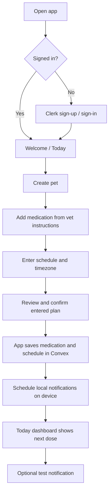
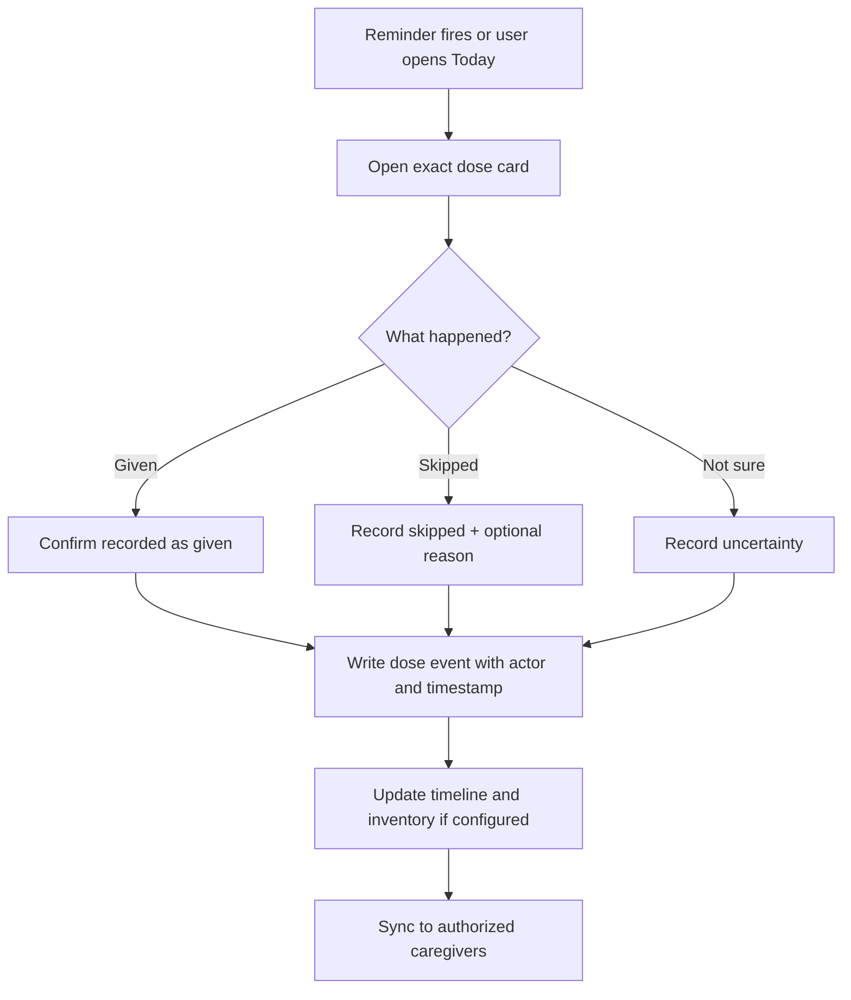
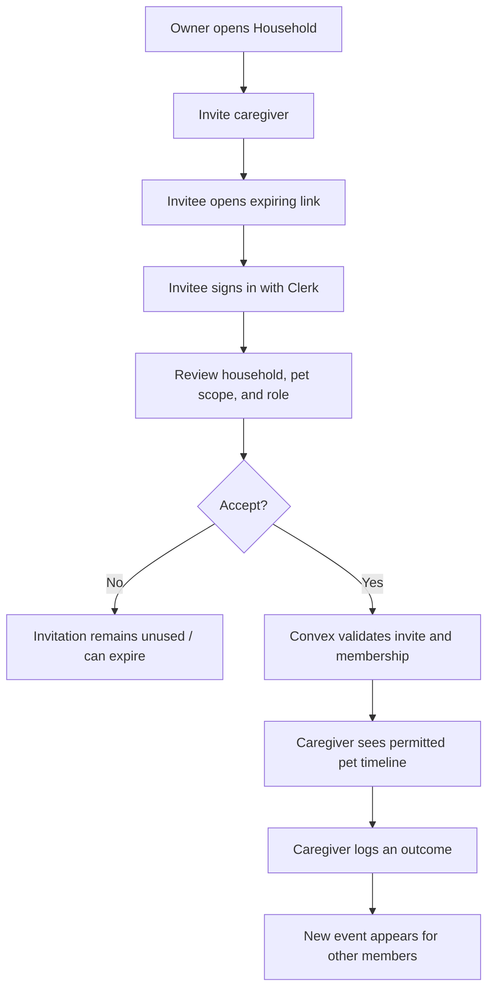
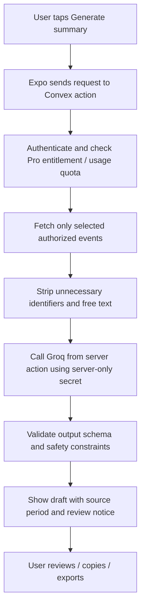
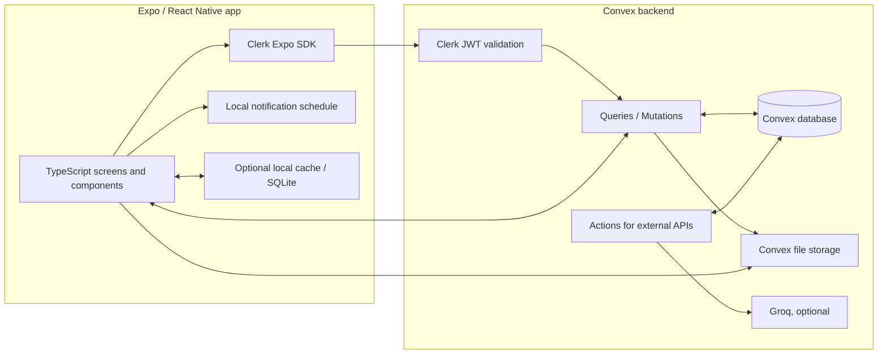

# Pet Medication Tracker — Complete Product & Technical Plan

**Working codename:** `PetHuddle` (placeholder only; do not commit to branding until app-store, domain, and trademark checks are complete)  
**Document version:** 1.0  
**Prepared:** 14 October 2026  
**Primary markets:** United States, United Kingdom, and Europe  
**Founder’s chosen stack:** Expo / React Native frontend + Clerk authentication + Convex backend/database  
**Product thesis:** *The easiest way for everyone who cares for a pet to know what happened with every scheduled medication dose.*

> **Scope note:** This is the full product blueprint, not merely an MVP checklist. It maps the mature product, pricing, user journeys, integrations, data model, safety rules, and roadmap. The 10-day plan is a launchable vertical slice; it is not realistic to complete and thoroughly validate every mature feature in 10 days as one founder.

---

## Contents

1. Executive decision
2. Product idea, mission, goals, and non-goals
3. Pain points and how we will be different
4. Who the app is for
5. Product principles and safety rules
6. Full feature map
7. Free vs Pro plan
8. Screens and navigation
9. End-to-end user flows
10. API and integration plan
11. AI feature plan (Groq)
12. Technical architecture: Expo + Clerk + Convex
13. Data model and ownership rules
14. Notifications and reminder reliability
15. Privacy, security, and safety
16. Monetization and MRR math
17. Analytics and success metrics
18. Testing plan
19. 10-day build plan and longer roadmap
20. Example user scenarios
21. Risks and decisions to defer
22. Official documentation and research links

---

## 1. Executive decision

Build a medication-adherence and handoff app for pet households, differentiated by **Dose Certainty**: each scheduled dose gets a clear shared state, a timestamp, the person who recorded it, and a visible history of edits. The core emotional job is not simply “remind me”; it is **“remove the uncertainty and awkward handoff when more than one person may be caring for my pet.”**

Many existing products already offer reminders, multiple pets, dose history, inventory alerts, and reports. For example, PillPaw lists one-tap dose logging, reminders, dose history, exports, and multi-pet Pro features; PawRx lists dose tracking, reminders, stock alerts, and a health report; Heel promotes reminder sharing for caretakers. Therefore we must **not** claim that reminders or sharing alone are unique. Our product experience should make “what is the status of this dose right now?” the central interaction, with clear `Given`, `Skipped`, and `Not sure` states, actor attribution, safe corrections, and a handoff view. Competitor pages are useful evidence of feature overlap, but they do not prove that users will switch or pay; validate that in interviews and tests.

### Decision summary

- **Primary differentiator:** Dose Certainty + caregiver handoff timeline.
- **Initial audience:** pet households with ongoing medications and two or more caregivers (partners, family members, pet sitters, foster carers). Start with dogs and cats; data model can support other species.
- **Free plan:** one pet, core medication scheduling and dose logging, local reminders, and recent history. Do not paywall the safety-critical ability to record whether a dose was given.
- **Pro plan hypothesis:** USD $4.49/month or $29.99/year, focused on multiple pets, shared caregivers, extended records, inventory/refill alerts, and vet-ready exports. Test pricing before treating it as settled.
- **Frontend:** Expo + React Native + TypeScript.
- **Authentication:** Clerk using `@clerk/expo`.
- **Backend/data:** Convex with Clerk JWT authentication and server-side authorization checks.
- **Local reminders:** `expo-notifications` for scheduled device-local reminders. Explain notification-permission and operating-system limitations clearly; never promise delivery is guaranteed.
- **AI:** optional, bounded, and server-side only. No AI is needed for the core reminder/logging loop. Future AI can summarize owner-provided notes or help transcribe a label, but the user must verify extracted text. Never use AI to diagnose, prescribe, calculate, or change a pet’s dose.
- **External veterinary API:** none required for the core product. OpenFDA’s animal/veterinary endpoint is an adverse-event reporting dataset, not a prescribing or dose-calculation service.

---

## 2. Product idea, mission, goals, and non-goals

### One-sentence idea

A shared medication command center for pet households that records each planned dose, reminds the right people, and makes uncertainty visible instead of silently guessing.

### Mission

Reduce avoidable confusion in pet medication routines by helping caregivers keep a clear, shared, owner-controlled record of medication instructions and what actually happened.

### Goals for the first 90 days

1. Validate that multi-caregiver medication uncertainty is a painful and frequent problem.
2. Ship a reliable core routine: create pet → enter veterinarian-provided medication instructions → schedule reminders → log outcomes → review history.
3. Make the app useful without AI or any third-party medication database.
4. Measure repeat use and willingness to pay before investing in complex integrations.
5. Establish a privacy-conscious architecture that can later support shared households, records, reports, and subscription entitlements.

### Suggested measurable product goals (hypotheses, not guarantees)

- At least 70% of testers who start onboarding create a pet and a medication schedule.
- At least 60% of activated testers log three or more dose outcomes in their first week.
- At least 30% of activated testers return during days 7–14.
- At least 5 out of 20 interview/test users express credible willingness to pay for shared caregiver history or multi-pet features; actual payment tests are stronger evidence than verbal intent.
- Zero unresolved critical data-ownership or dose-logging bugs before a broader launch.

### Non-goals (especially for v1)

- Diagnosing symptoms, recommending medication, setting or changing a dose, or advising whether to repeat a dose after uncertainty.
- Replacing the veterinarian, pharmacy, medical record system, or prescription label.
- Automatically treating third-party drug data as a source of individualized veterinary instructions.
- Promising that notifications will always arrive.
- Claiming the app prevents all missed or duplicate doses.
- Building a social feed, pet marketplace, tele-vet service, or full veterinary practice-management system before the core workflow is validated.
- Using pet medication data for ad targeting or selling it.

---

## 3. Pain points and how we will be different

### The problem we target

A typical reminder app answers: **“It is time for the medication.”** The hard real-life questions are often:

- “Did my partner already give it?”
- “The dog sitter says they handled it, but where is that recorded?”
- “I was interrupted; I cannot remember whether I gave the dose.”
- “Which instruction did the vet give, and when did we start this medication?”
- “We are running low. Who is responsible for arranging the refill?”
- “Can I show the vet an accurate timeline without reconstructing it from messages?”

A reminder by itself cannot confirm a dose was administered. A scheduled notification is not proof that a caregiver saw it, and a tap is not proof of clinical administration. Our language must say **“recorded as given by [caregiver] at [time]”**, rather than claiming the app verifies the physical dose.

### Signature feature: Dose Certainty

Every planned event has one of these states:

| State | Meaning | App behavior |
|---|---|---|
| **Upcoming** | The scheduled time has not arrived. | Show the planned time and owner-entered instructions. |
| **Due** | The scheduled time is here and no outcome has been recorded. | Show the dose card and reminder status. |
| **Recorded as given** | A caregiver explicitly logged that they gave it. | Record actor and timestamp; sync to other authorized caregivers. |
| **Skipped** | A caregiver explicitly recorded that it was not given. | Require an optional/short reason; do not infer future dose changes. |
| **Not sure** | The caregiver cannot confidently say whether it was given. | Make uncertainty highly visible; do not recommend a repeat dose. Direct the user to existing veterinary instructions or their veterinarian. |
| **Overdue / unresolved** | The planned time passed without a confirmed outcome. | Display as unresolved, not “missed” with certainty; user may log what happened. |

Use neutral status names. Do not shame a caregiver or produce manipulative “perfect streak” messaging.

### Differentiation pillars

1. **One source of truth:** all invited caregivers see the same record, subject to access permissions.
2. **Uncertainty is a first-class state:** “Not sure” is allowed, visible, and never silently converted into “given” or “missed.”
3. **A usable handoff:** “Last recorded dose, next scheduled dose, what needs attention, and who last updated the record” are easy to see in one place.
4. **Transparent history:** record who changed what and when; corrections do not erase the original audit trail.
5. **Vet-ready timeline:** export the record as a factual log, clearly distinguishing scheduled events, caregiver entries, edits, and unknowns.
6. **Safety before AI:** predictable reminders and logs work without a language model; AI can only assist with organization, never with care decisions.

### Competitor reality check

| Competitor/product | Publicly listed capabilities | What that means for us |
|---|---|---|
| PillPaw | One-tap logging, reminders, next/last dose indicators, history, reports, multiple pets and Pro features. | “One tap” or “reports” are not unique. We need a more coherent shared certainty/handoff experience. |
| PawRx | Multiple-pet tracking, reminders, a medication calendar, stock/refill alerts, health profile and report. | Inventory and multiple pets are not unique. Focus on the shared state, edits, and caregiver handoff. |
| Pet Pill Reminder & Tracker | Flexible schedules, multi-pet records, dose logs, stock thresholds and low-stock alerts, export. | These are expected category features and should be planned, but not our primary positioning. |
| Heel | Caretaker reminder sharing, prescription/medical record features and refill request-related workflows. | Caregiver sharing already exists in the market; our differentiator must be the quality and transparency of the dose event itself. |
| PetDesk | Vet-provider discovery, reminders, clinic connectivity and refill request functionality. | Do not try to replicate an entire provider network. A personal medication timeline can work independently of a participating clinic. |

Competitor evidence is drawn from publicly available product descriptions and should be rechecked before launch: [PillPaw App Store](https://apps.apple.com/us/app/pillpaw-pet-medicine-tracker/id6757088944), [PawRx Google Play](https://play.google.com/store/apps/details?id=app.pawrx.android), [Pet Pill Reminder & Tracker Google Play](https://play.google.com/store/apps/details?id=com.quickseedlabs.pet_pill_reminder), [Heel Pet Parents](https://www.heelapp.com/pet-parents), [PetDesk Google Play](https://play.google.com/store/apps/details?id=com.locai.petpartner).

### Standout positioning

**Headline:** “No more ‘Did you give the medication?’”  
**Subheadline:** “Keep every pet medication schedule and caregiver update in one clear timeline—so your whole household knows what’s been recorded, what’s next, and what still needs checking.”  
**Short promise:** “Every dose. One shared record.”

Avoid unsupported claims such as “never miss a dose,” “guaranteed reminders,” or “vet approved” unless the product has actual substantiation and permission.

---

## 4. Who the app is for

### Primary persona: the shared-care household

- Owns one or more pets taking daily, weekly, or time-limited medication.
- A partner, relative, sitter, or foster caregiver occasionally gives care.
- Uses messages or memory to coordinate today.
- Is anxious about accidental duplicate doses or uncertain records.
- Wants a quick app, not a complex electronic medical record.

### Secondary personas

- **Multi-pet household:** several pets and different schedules.
- **Temporary pet sitter:** needs limited access for a specific time period.
- **Long-term treatment caregiver:** needs a dependable history to share with a veterinarian.
- **Solo caregiver:** wants reminders, stock tracking, and records even without sharing.

### Not the initial target

Veterinary clinics as a full SaaS customer, pharmacies, emergency services, or users wanting the app to tell them what medication/dose to give. Those markets add integration, clinical, legal, and support complexity.

---

## 5. Product principles and safety rules

1. **The user enters the prescribed plan.** Medication name, amount, route, frequency, and notes must be copied from veterinarian-provided instructions or entered according to the owner’s verified directions.
2. **Never calculate or suggest a dose.** The app may store a free-text instruction exactly as entered. It must not derive dosage from weight/species/age or tell a user to increase, skip, double, or repeat medication.
3. **Uncertainty stays uncertain.** If a caregiver chooses “Not sure,” never recommend administering another dose. Say that the app cannot determine what to do; consult the prescribing veterinarian or the written instructions they supplied.
4. **Separate plan from events.** A medication schedule is what the caregiver entered; a dose event is what the caregiver says happened. Do not conflate planned with actual.
5. **Every change is attributable.** Preserve who created/edited a medication, when, and what changed; use soft deletion for auditability where appropriate.
6. **No AI in critical path.** Reminders, permissions, dose logging, schedule validation, and billing entitlements must be deterministic.
7. **Explain notification limits.** Device settings, Focus/Do Not Disturb, power-saving modes, permissions, OS scheduling limits, and app uninstall can affect reminders.
8. **Least privilege.** A sitter should not automatically gain the ability to delete a household or change medication instructions.
9. **Privacy by default.** Only collect information needed for the pet-care task. No sale of personal data; no health-record-based advertising.
10. **No medical endorsement claims without evidence.** “Designed as a tracking aid, not veterinary advice” should be visible in onboarding and settings.

---

## 6. Full feature map

This is the mature product map. Statuses describe priority, not a promise everything is in the first release.

### P0 — Launch essentials

- Clerk sign-up/sign-in and session handling.
- Create one pet profile with name, species, optional photo and timezone.
- Add a medication record from owner-entered veterinary directions.
- Set schedule type and time(s); support start/end dates and “as needed” as a non-scheduled tracking mode.
- Daily dashboard showing each due/upcoming/unresolved dose.
- One-tap `Recorded as given`, `Skipped`, or `Not sure`.
- Event timestamp, actor, and notes; correction flow with audit entry.
- Local reminders using Expo Notifications and permission state.
- Medication detail, upcoming schedule, and dose history.
- Basic settings: timezone, notification preferences, sign out, delete account/data request/contact.
- Basic privacy policy, terms, support contact, and safety disclaimer.
- Server-side authorization on every Convex query/mutation.

### P1 — First paid-value / early post-launch

- More than one pet.
- Multiple caregivers within a shared household, with owner/admin/caregiver/read-only roles.
- Invitation link/token with expiry and revoke support.
- Shared dose event updates and caregiver identity.
- Caregiver handoff screen and unresolved-dose view.
- Medication inventory entered by user; consumption decrement only when the user confirms an event was given and the quantity rules are explicit.
- Low-stock threshold and refill reminder.
- Extended history/search/filter.
- CSV/PDF export of medication plan and event history.
- Pet notes, vet visits, weight entries and appointment reminders (these are records/reminders, not medical interpretation).
- Cloud backup and restore through Convex.
- Premium entitlement and paywall; restore purchases.
- Error monitoring, crash reporting and product analytics with minimal data.

### P2 — Mature consumer product

- Optional medication-label/document capture and OCR-assisted form prefill. Preserve the source image and show extracted fields as **unverified** until the user reviews and confirms every field.
- Calendar export or optional calendar integration after privacy and edge cases are tested.
- More granular schedule rules: alternate days, selected weekdays, short treatment courses, and time windows.
- Timezone travel flow that previews how scheduled events will display when a user changes timezone; never silently shift the intended instructions.
- Sitter mode with access expiry and limited permissions.
- More flexible event tags: late, declined, vomited after dose (user-reported only), or note. These must not generate clinical advice.
- Shareable vet report with date range, audit events, medication plan version, and clear source labels.
- Optional email reminders as a secondary channel, with explicit opt-in.
- Widgets and improved home-screen shortcuts.
- Localization: English first, then carefully reviewed additional languages and locale-aware date/time formats.
- Accessibility improvements: screen readers, large text, strong contrast, reduced motion, accessible hit targets.

### P3 — Partner / advanced platform

- Vet-approved plan sharing and clinic workflow only if a partner relationship and data exchange protocol exists.
- Vet portal/clinic team controls with explicit permissions.
- Prescription refill request integrations where a provider actually supports them.
- Household activity log, member management and more advanced audit/export policies.
- Optional integrations with pet insurance or pet record platforms, subject to partnerships and legal review.
- Family notifications through remote push/email with preference, quiet-time, rate-limit, and opt-out controls.
- Multiple-region data hosting options if justified by customer demand and available provider support.

### Explicitly avoid unless strong evidence appears

- AI veterinarian / diagnosis chatbot.
- Dose calculator or “missed dose—give it now” engine.
- Automatic medication recognition that saves fields without owner verification.
- User-generated dosing database or crowd-sourced medical recommendations.
- Public social feed of pet medical records.
- Ads targeted using pet medication/medical details.
- Gamified “perfect adherence” scores that shame owners or hide legitimate skipped/uncertain events.
- “We guarantee no missed doses” marketing.

---

## 7. Free vs Pro plan

Pricing is a hypothesis to test in the USA/UK/EU. The exact local currency and tax-inclusive presentation should be configured through store products and reviewed for each market.

### Free — “Core care”

Designed so a pet owner can use the central safety workflow before paying.

- 1 pet profile.
- Medication schedules and user-entered instructions for that pet.
- Core reminder scheduling on the device.
- Unlimited dose outcome logging for the free pet.
- `Recorded as given`, `Skipped`, and `Not sure` statuses.
- Basic dose history (suggested: last 30 days).
- Basic daily dashboard and next scheduled event.
- Notification-permission check and in-app explanation of how to enable notifications.
- Basic medication notes.
- Standard support/FAQ.
- Account deletion and data export request path.

**Safety principle:** do not paywall the ability to record a dose outcome or clarify that a dose is uncertain. If the device is offline, locally cached views should remain available where implemented; the interface must visibly indicate when cloud sync has not completed.

### Pro — “Shared care”

**Initial pricing to test:** $4.49/month or $29.99/year (annual plan is a hypothesis; do not ship both prices until you can support and explain them clearly).

- Multiple pet profiles.
- Shared household / caregiver invites (suggested cap for early plan: up to 5 caregivers; increase later if needed).
- Shared dose timeline with caregiver identity.
- Handoff dashboard and unresolved-dose overview.
- Extended or unlimited history.
- Inventory / low-stock alerts / refill reminders.
- PDF/CSV reports for a veterinarian.
- Health notes, weight and vet visit records.
- Backup/restore and device-to-device sync.
- Sitter access expiry and role controls as they become available.
- Pro widgets and advanced reminder customization when proven reliable.
- Priority support only if the founder can actually deliver it.

### Trial recommendation

Consider a 7-day Pro trial **after** the core app is stable and after validating that Pro features feel valuable. Keep safety features available after trial ends. Do not make the app delete records or stop existing reminders merely because a user cancels. On cancellation, read-only access and export should remain available; clearly disclose any limits before purchase.

### Example paywall copy

**Headline:** “Care works better when everyone is in the loop.”  
**Body:** “Add every pet, invite the people who help care for them, and keep the dose timeline, refill reminders, and vet-ready records together.”  
**CTA:** “Try Shared Care Pro”  
**Reassurance:** “Your pet’s record stays yours. You can export your data and manage or cancel your subscription in your account settings.”

### Feature gating matrix

| Feature | Free | Pro |
|---|---|---|
| One pet | Yes | Yes |
| Core medication schedules | Yes | Yes |
| Core reminders | Yes | Yes |
| Log given/skipped/not sure | Yes | Yes |
| Basic history | Last 30 days (suggested) | Extended/unlimited |
| Multiple pets | No | Yes |
| Caregiver sharing | No or invite-only beta | Yes |
| Caregiver audit/handoff view | Basic single-user history | Full shared timeline |
| Stock/refill tracking | Basic manual notes or limited | Full alerts |
| PDF/CSV export | Limited/manual export decision | Full export |
| Vet visits/weight/health notes | Basic notes | Full timeline |
| OCR-assisted entry | Small limited allowance later, after safety testing | Higher allowance only if AI/OCR costs justify it |
| AI summaries | Not required for launch | Optional quota-based later feature |

**Important:** Do not put paid features in the table until they exist and have been tested. A planned capability is not a shipping feature.

---

## 8. Pages and navigation

### Main tab navigation

Use four primary tabs to keep the app obvious:

1. **Today** — doses due, upcoming, and unresolved.
2. **Pets** — profiles and each pet’s medication list.
3. **History** — dose timeline and filters (Pro can unlock extended range, but always show useful recent history for free).
4. **Settings** — notifications, household, plan, privacy, help, account deletion.

A clear global `+ Add` button can create a pet, medication, health note, or vet visit according to the current screen context.

### Screens inventory

| Screen | Purpose | Key components/actions |
|---|---|---|
| Splash / session loading | Restore auth/session and app state | Progress indicator; avoid flashing login before Clerk session resolves. |
| Welcome | Explain the promise and safety boundary | “A shared record for every pet dose”; Continue. |
| Sign up / sign in | Identity | Clerk-supported email/Google/Apple etc. based on configured providers. |
| Pet onboarding | Create first pet | Name, species, optional breed/birthday/photo. Keep optional data optional. |
| Notification explainer | Ask in context | Explain why reminders help, then request OS permission at the appropriate time. |
| Today dashboard | Daily command center | Pet switcher, due/upcoming/unresolved dose cards, next dose, last record and actor. |
| Add medication — details | Store plan from vet instructions | Name, form, exact instruction text, optional label photo for later OCR feature. |
| Add medication — schedule | Define reminders | Frequency, times, start/end date, timezone, as-needed toggle. Preview next events. |
| Confirm schedule | Prevent typos | Show exact plan and ask user to confirm against veterinarian-provided directions. |
| Dose action sheet | Record what happened | Given / Skipped / Not sure, optional note, confirm timestamp. |
| Not-sure guidance | Safely handle uncertainty | “This app can’t determine whether another dose should be given. Check your vet’s instructions or contact your veterinarian.” |
| Medication details | View/edit plan | Schedule, instruction text, last logged outcome, stock (when available), pause/archive. |
| Pet profile | Pet-specific overview | Medications, notes, weight, vet visits, household access. |
| History timeline | Review recorded events | Filters by pet/medication/state/caregiver/date; corrections visible. |
| Care household | Share access (Pro/Phase 2) | Invite, role, pending members, revoke access. |
| Invite acceptance | Join a household | Explain who invited user, household/pet scope, role, accept/decline. |
| Inventory/refill | Maintain stock | Quantity, units, warning threshold, expected depletion estimate labeled as estimate. |
| Vet report | Generate export | Select date range, review included fields, create PDF/CSV, share using OS share sheet. |
| Paywall / subscription | Explain plan value | Free/Pro table, price localized by store, manage/restore purchase. |
| Notification settings | Show permission state | Reminder preferences, test notification, OS settings link where supported. |
| Privacy & data | Transparency and control | Privacy policy, export/delete request, app version, third-party service list. |
| Help & support | Resolve confusion | FAQ, report a bug, contact email. |

### UX rules

- The most common action (log dose) should need one or two taps, not a multi-screen form.
- Put pet name and medication name visibly on every dose card to reduce wrong-pet mistakes.
- Confirm destructive edits (archive medication, delete pet, remove caregiver).
- Use color plus readable labels/icons; never rely on color alone for statuses.
- Date/time should be explicit; show local timezone if travel or timezone change creates ambiguity.
- A notification tap should open the specific pet/medication/dose event, not a generic home screen.

---

## 9. End-to-end user flows

### Flow A — First-time user to first scheduled reminder



**Example:** Sam creates a profile for Milo, enters the medication name and copies the exact directions from the vet label, then sets the prescribed time. The app repeats the entered plan back to Sam for checking. Sam enables reminders. The app stores the medication plan and creates local reminders on the phone. The app does not decide the dose.

### Flow B — Recording a dose



**Example:** At the scheduled time, Sam taps “Recorded as given.” A dose event is written with Sam’s account identity and the time of the tap. A second caregiver then sees the same status. The system should describe it as “Sam recorded this dose as given,” not “dose verified.”

### Flow C — Caregiver handoff (Pro / Phase 2)



Every shared mutation must validate membership and role on the server. Do not trust the client to pass an arbitrary household or pet ID.

### Flow D — “Not sure” / possible duplicate dose

1. User opens the dose card and selects **Not sure**.
2. App stores `uncertain` with actor, timestamp, and optional note.
3. Dashboard shows “Needs checking” for the relevant event.
4. App does **not** suggest giving, repeating, skipping, or rescheduling a dose.
5. Display: “PetHuddle cannot determine what to do when a dose may or may not have been given. Check the written instructions from your veterinarian or contact your veterinarian.”
6. If later corrected, add a correction event with who changed it and why; preserve the prior uncertainty in history.

### Flow E — Medication refill

1. User enters the current quantity and unit, plus a low-stock threshold.
2. When a dose is explicitly recorded as given, update stock according to the user-defined quantity consumed for that event.
3. Warn when a threshold is reached or an estimated quantity is low.
4. Label depletion date as an estimate based on the schedule and logged doses—not a guarantee.
5. Provide a “Contact my vet/pharmacy” reminder or link the user configures; do not claim the app can authorize a refill.

### Flow F — Share a report with a vet

1. User opens a pet profile → Vet Report.
2. Chooses date range and included sections.
3. Preview shows the medication plan as entered, scheduled events, recorded outcomes, uncertain/skipped entries, caregiver names (according to privacy settings), and corrections.
4. User generates PDF/CSV and chooses how to share it via the operating-system share sheet.
5. Export includes the disclaimer: “This report reflects entries recorded in the app and is not an independently verified medical record.”

---

## 10. API and integration plan

### Core integrations (launch)

| Technology / API | Use | When in flow | Key notes |
|---|---|---|---|
| **Clerk (`@clerk/expo`)** | Sign-up, sign-in, session management | App start and authenticated access | Clerk supports Expo/React Native flows; enable Native API when required by current setup. Keep only publishable key in client config. |
| **Convex** | Data queries/mutations, realtime sync, backend functions | Pets, medication plans, events, household and subscription records | Configure Clerk JWT auth in Convex and enforce authorization inside every server function. |
| **Expo Notifications (`expo-notifications`)** | Schedule local reminders and handle notification taps | After schedule confirmation; whenever a schedule changes | Local notifications can work without a server call at delivery time. Ask permission in context and test on physical devices. Push notifications require a development build for supported Expo SDK/platform combinations; don’t confuse local and push. |
| **Expo Image Picker / Camera** | Pet photo and future medication-label photo | Pet setup or later OCR workflow | Store private files carefully. Label images may contain personal details; require consent and delete controls. |
| **Convex File Storage** | Store pet photos/report assets as needed | Uploads | Use generated upload URLs and permission checks; avoid making medication label images public. Docs: https://docs.convex.dev/file-storage/upload-files |
| **RevenueCat (`react-native-purchases`)** | In-app subscription abstraction across Apple/Google | Pro purchase and restore | Requires an Expo development build for native purchase testing. Configure App Store / Play products. Use server-side entitlements/verified webhooks or an appropriately secured integration—not a client boolean—to gate Pro features. |
| **Sentry or equivalent error reporting** | Crash/error monitoring | Beta and production | Do not send medication names, label text, or other sensitive free-text fields in logs by default. |

### Optional / later integrations

| Integration | Value | Decision |
|---|---|---|
| **Groq API** | Draft summaries of an already-recorded timeline or help organize notes | Phase 2, optional. Not needed for reminders or dose decisions. Calls must be server-side only. |
| **openFDA Animal & Veterinary API** | Public animal drug adverse-event reports | Optional educational/reference page only after careful review. It is not a veterinary dose database and does not provide individualized dosing advice. Source: https://open.fda.gov/apis/animalandveterinary/event/how-to-use-the-endpoint/ |
| Petfinder / dog breed / cat breed APIs | Pet adoption or breed content | Not core to this app; adds little to medication adherence. Avoid creating dependency on it. |
| Google Places / maps | Find nearby veterinary practices | Later only if there is a strong user need. Requires API key, billing and geographic review; show sourced listings accurately. |
| OCR provider or on-device OCR | Reduce typing from medicine-label photos | Later; OCR must be a draft, never trusted automatically. Compare privacy, accuracy, commercial terms and platform behavior before selection. |
| Email provider (e.g. Resend) | Invitation emails, backup/share link messages | Needed only if we send custom transactional emails. Review current free tier, limits, and deliverability before selecting. |
| Calendar integration | Add non-clinical reminders to a user's calendar | Optional later; ensure user consent and clear time-zone behavior. |

### What free/public medical APIs actually provide

There is no general-purpose free public API that we should rely on to determine a pet's correct medication dose. The openFDA animal/veterinary dataset exposes adverse-event reports, which are useful for research/monitoring and are not proof of causation or a personalized treatment plan. Do **not** search a drug name and use the result to recommend a dose. For the product’s core workflow, the authoritative source is the owner's verified veterinary instruction.

### The API sequence by user action

| User action | Frontend | Clerk | Convex | Device / external API |
|---|---|---|---|---|
| Sign in | Show Clerk flow | Issues session/token | Receives authenticated requests via Convex provider | No medication API needed |
| Create pet | Form validation | Supplies identity | `pets.create` validates authenticated user and writes pet | Optional photo picker; upload to Convex storage later |
| Add medication | Collect name, instructions, schedule | Token attached | `medications.create` validates pet access and writes plan | No drug lookup needed |
| Create reminders | Save and preview next dates | Not directly involved | Returns canonical schedule/ID | `expo-notifications` schedules local notifications and saves returned notification IDs locally |
| Log given/skipped/not sure | Confirm outcome | Token attached | Mutation verifies owner/caregiver permission and writes dose event | Update local notification set; update stock only under explicit rules |
| Invite caregiver | Create invite from settings | Invitee authenticates on acceptance | Generates/validates single-use, expiring invite; stores membership | Optional email provider sends link later |
| Upload photo | Choose image | Token attached | Generate restricted upload URL and verify ownership | Client uploads image to Convex Storage |
| Generate AI summary | User requests it explicitly | Token attached | Auth/rate-limit, minimize payload, call AI in an action | Groq endpoint; output treated as draft summary only |
| Buy Pro | Present localized product | User identity mapped to purchaser | Validate entitlement state and gate server-side features | RevenueCat + Apple/Google billing systems |

---

## 11. AI feature plan (Groq)

### The right role for AI

AI is a convenience feature, not the source of medical truth. Avoid adding a chatbot just to say that the app has AI.

**Good later features:**

- Turn structured, already-logged dose events into a neutral summary: “Three events were recorded as given, one was skipped, and one remains uncertain in the selected period.”
- Summarize the user’s own care notes without adding medical interpretation.
- OCR-assisted draft entry from a label photo, if the selected model/service supports image input—or use a suitable OCR engine separately. The user checks the image and confirms every extracted field before saving.
- Help rewrite a user-entered note into clearer wording without changing factual content.

**Never do:**

- Recommend or calculate doses.
- Suggest whether to repeat a dose, change a frequency, or stop medication.
- Diagnose symptoms or tell users adverse events are caused by a medicine.
- Invent medication instructions from a drug name.
- present AI-generated text as vet-approved.

### Safe architecture



### Implementation rules

- Store the Groq API key in Convex environment variables / server-side secrets. **Never place it in an Expo `EXPO_PUBLIC_*` variable or mobile bundle.**
- Rate-limit per user and household, impose request/token caps, and add a daily allowance.
- Cache summaries by normalized input version when appropriate; invalidate when event data changes.
- Send the minimum necessary data. Prefer precomputed counts and event labels over label photos or all pet records.
- Validate output against a strict schema; reject or remove dosing advice or unsupported medical claims.
- Provide a non-AI fallback when the model is unavailable or the account’s free quota is hit.
- Handle HTTP `429`, timeouts and malformed output. Do not retry indefinitely.
- Do not call the model on every reminder or dose log. AI should only run after an explicit user request.
- Review current Groq models, free quotas, model availability and terms in the account console before launch; quotas and prices can change.

### AI cost planning

For a low-volume summary feature, cost depends on selected model, prompt/output sizes, cache hit rate, and current quotas. Model costs and free-tier limits change, so this plan intentionally does not promise a fixed free allocation. At launch, make AI usage optional and measure cost per successful summary before adding it to Pro. Core app should continue to work at **zero AI spend**.

---

## 12. Technical architecture: Expo + Clerk + Convex

### Architecture overview



### Frontend

- Expo + React Native + TypeScript.
- Use Expo Router or a similarly clear navigation scheme; be consistent.
- Use the current compatible versions of `expo`, `@clerk/expo`, `convex`, and native packages as documented at implementation time; do not blindly paste outdated package versions from a blog post.
- UI foundations: reusable dose card, status badge, pet avatar, form input, confirmation dialog, empty state, notification permission banner, paywall component.
- Form schema validation: use a consistent typed validation system (e.g. Zod) at the client and server boundary.
- Store local notification IDs and schedule metadata so changed/cancelled medication plans can cancel old reminders before scheduling new ones.
- If offline functionality matters, add `expo-sqlite` as a local cache/outbox in a deliberate phase. Convex’s normal cloud-first queries should not be described as a full offline-first system without building and testing conflict resolution.

### Authentication — Clerk

- Use `@clerk/expo` and follow Clerk’s current Expo quickstart.
- Clerk handles identity and session lifecycle; Convex functions enforce application data access.
- Wrap the app using the supported Clerk + Convex provider integration for the chosen versions.
- Configure the Clerk issuer domain/JWT settings in Convex (`convex/auth.config.ts` according to the current Convex guide).
- Store no passwords in Convex.
- Avoid passing a user ID from the frontend and assuming it is valid. In Convex, derive identity from `ctx.auth.getUserIdentity()` and compare it to the stored membership/owner records.

### Backend — Convex

Organize functions by domain, for example:

- `users.ts` — profile bootstrap and user preferences.
- `pets.ts` — create/update/archive pet; list pets visible to current user.
- `medications.ts` — create/update/pause/archive medication plan.
- `doseEvents.ts` — log outcome, add correction, query history.
- `households.ts` — create household, invite, accept/revoke membership (Phase 2).
- `inventory.ts` — stock and low-stock thresholds (Phase 2).
- `reports.ts` — prepare an authorized report dataset and/or export metadata.
- `subscriptions.ts` — entitlement reads and webhook processing (when billing is launched).
- `ai.ts` — bounded, server-only calls (Phase 2).

Use Convex mutations for validated data changes, queries for reads, actions for external network calls, and scheduled functions only for backend jobs that truly need to run on the server. Device medication reminders should not depend exclusively on a backend scheduled job.

### File uploads

For pet photos or future label photos, use Convex upload URLs following the current file-storage guide. Verify pet/household access before issuing an upload URL; do not expose sensitive record images through public links by default. Define retention and delete behavior for uploaded files.

### Subscription implementation

RevenueCat is a reasonable candidate for simplifying Apple App Store and Google Play subscriptions, but it adds a native development-build requirement. Start by implementing the plan/entitlement model and paywall screens with a development flag; integrate purchase/restore once the core product is stable. In production, verify entitlement state on the backend using the provider’s recommended secure webhook/entitlement approach. Never allow the client to set `isPro: true`.

### Environments and secrets

- `.env.local` for local Expo public config only; no secret keys.
- Convex dashboard environment variables for server secrets: Groq key, webhook secrets, and any email provider API key.
- Separate development and production Clerk/Convex configurations.
- Publishable Clerk key and Convex deployment URL are client config, but server secrets remain server-side.
- Add a `README.md` documenting setup and required dashboard settings.

### Suggested repository structure

```text
app/
  (auth)/
  (tabs)/
    today.tsx
    pets.tsx
    history.tsx
    settings.tsx
  pets/
  medications/
  dose-events/
  household/
  reports/
components/
  DoseCard.tsx
  DoseStatusBadge.tsx
  PetAvatar.tsx
  FormField.tsx
  EmptyState.tsx
lib/
  convex.ts
  clerk.ts
  notifications.ts
  dateTime.ts
  validation.ts
  analytics.ts
convex/
  _generated/
  schema.ts
  auth.config.ts
  users.ts
  pets.ts
  medications.ts
  doseEvents.ts
  households.ts
  inventory.ts
  reports.ts
  subscriptions.ts
  ai.ts
```

---

## 13. Data model and ownership rules

This is a logical model; adjust field types/indexes to match current Convex conventions during implementation.

### Tables / collections

#### `userProfiles`

- `clerkUserId` (stable identity subject; indexed, unique by convention)
- `displayName` (optional)
- `email` (optional if needed; avoid duplicating unnecessary identity data)
- `timezone`
- `createdAt`, `updatedAt`
- `planHint` only if useful for UI; real paid entitlements should come from a verified billing source

#### `pets`

- `ownerUserId` or `householdId`
- `name`, `species`, `breed` (optional), `birthDate` (optional), `photoStorageId` (optional)
- `archivedAt` (optional)
- `createdBy`, `createdAt`, `updatedAt`

#### `households` (Phase 2)

- `name`
- `createdBy`
- `createdAt`, `updatedAt`

#### `householdMembers` (Phase 2)

- `householdId`, `clerkUserId`
- `role`: `owner | admin | caregiver | viewer`
- `status`: `active | invited | revoked`
- `invitedBy`, `joinedAt`, `revokedAt`

#### `householdInvites` (Phase 2)

- `householdId`, `petScope` (optional list or relationship table), `role`, `tokenHash`
- `expiresAt`, `createdBy`, `acceptedBy`, `acceptedAt`, `revokedAt`
- Use high-entropy tokens, store a hash where feasible, single-use acceptance, and expiration. Do not treat an unguessable URL alone as sufficient authorization after acceptance.

#### `medications`

- `petId`, `householdId` (if sharing is implemented)
- `displayName`, `form` (optional), `instructionText` (owner-entered verbatim)
- `scheduleType`: e.g. `scheduled | as_needed`
- `schedule` structured object containing frequency/time rules, start/end dates, timezone and any allowed windows
- `quantityPerAdministration` only as **user-entered text/structured field**, never auto-calculated or suggested by AI
- `inventoryEnabled`, `currentStock`, `stockUnit`, `lowStockThreshold` (later)
- `status`: `active | paused | completed | archived`
- `planVersion`, `createdBy`, `createdAt`, `updatedBy`, `updatedAt`

#### `doseEvents`

- `petId`, `medicationId`, `scheduledFor` (if tied to a schedule event)
- `status`: `given | skipped | uncertain | corrected` (or model corrections as separate events)
- `recordedAt`, `recordedBy`
- `givenAt` only when caregiver records the actual/estimated time
- `note` (optional; treat as potentially sensitive free text)
- `source`: `manual | notification_action | import` (only supported sources)
- `correctsEventId` or `supersedesEventId` (optional)
- `createdAt`; preserve audit data instead of silently overwriting original event

#### `medicationScheduleOccurrences` (optional, implementation-dependent)

- One record for each scheduled occurrence if server-side history/household sync requires it, or compute occurrences from schedule with clear rules.
- If materializing occurrences, define idempotency keys so a timezone edit or retry cannot create duplicate events.
- A scheduled occurrence is **not** a dose event and should never be treated as administered.

#### `inventoryEvents` (Phase 2)

- `medicationId`, delta, reason, linkedDoseEventId (optional), actor and timestamp
- Use an event ledger for corrections rather than silently rewriting inventory history.

#### `vetVisits` / `petNotes` (Phase 2)

- `petId`, date/time, summary text, attachment IDs if supported, createdBy, timestamps

#### `subscriptions` / `entitlements`

- Provider customer ID, entitlement/status, original purchase ID where supported, last verified time
- Updated only from verified backend flow/webhooks; not client input

#### `auditEvents`

- Actor, object type/id, action, timestamp, minimally necessary before/after diff, reason for correction when supplied
- Restrict access. Do not log more data than necessary.

### Authorization invariant

Every query and mutation must answer: **“Is the currently authenticated Clerk identity allowed to perform this action on this specific pet/household?”**

- Solo v1: pet owner identity must match authenticated identity.
- Shared v2: active membership and role must allow the requested action and pet scope.
- The frontend can hide controls but is not a security boundary.
- Add test cases that attempt access using another user’s pet ID.

### Dose history vs medication plan version

A medication schedule may change after a veterinary appointment. Preserve prior schedule versions or store an audit record so an old dose timeline still shows which plan was in effect at the time. Do not retroactively rewrite the meaning of past dose events when the current schedule is changed.

---

## 14. Notifications and reminder reliability

### Recommended launch approach: local notifications

For each active medication schedule, the device computes the next set of reminder dates based only on user-entered schedule rules. The app schedules local notifications using `expo-notifications` and stores each returned notification ID locally. When the medication is edited, paused, archived, or deleted, cancel related notifications and reschedule from the current plan.

Because platform scheduling constraints vary, use a rolling scheduling horizon and refresh future reminders on app foreground, schedule edits, timezone changes, and relevant app lifecycle events. Test both iOS and Android on physical devices. Use a `setNotificationHandler` so notification behavior while the app is open is explicitly configured.

### Reminder lifecycle

1. User confirms a medication schedule.
2. App verifies required fields and shows a human-readable preview.
3. App stores the schedule in Convex.
4. App requests notification permission with context if not already granted.
5. App creates local notification(s) and stores returned IDs locally.
6. Notification tap routes into the exact pet/medication/scheduled occurrence.
7. User records outcome; UI and backend timeline update.
8. App cancels/reschedules future notifications if the medication schedule changes.
9. Settings display whether OS notification permission is allowed and provide troubleshooting steps.

### Safety and reliability caveats

- A local reminder being scheduled does not guarantee that it will be shown at the exact time under every OS/device condition.
- If notification permission is denied, do not silently imply reminders are active; show a persistent, non-intrusive status.
- Do not set a notification action to “Given” automatically. The user must explicitly confirm the outcome in-app or via a carefully implemented action.
- If multiple caregivers use the app on different devices, local reminders are device-specific. Shared caregiver push reminders require a separate remote-notification design and opt-in rules.
- Android exact-alarm behavior and OEM power-saving settings must be tested for chosen Expo/Android versions before making claims about precision.
- When a user changes timezone, show a preview before changing future local notification times.
- Do not rely solely on Convex scheduled functions for medication reminders; server jobs cannot guarantee that a handset receives a message.

---

## 15. Privacy, security, and safety

### Data minimization

Collect only information required for core use. A pet’s medication record can still reveal personal circumstances about the human caregiver, so treat notes and images with care. Avoid sending full notes, labels, pet identity, or email to AI services unless needed and explicitly disclosed.

### Security checklist

- Clerk-managed authentication and supported secure session storage.
- Convex server-side identity checks for all records.
- Least-privilege household roles and invitation expiration/revocation.
- No API secret in the mobile bundle.
- TLS transport and provider-managed storage security.
- Validate all schedule, status and quantity inputs on the server.
- Idempotency for event creation and webhook processing.
- Rate limiting for invitations, exports, AI, and auth-adjacent actions.
- Audit important changes and access changes.
- Separate dev and production environments and test data.
- Monitor errors while scrubbing private content from logs.
- Provide account/data deletion and explain backup retention/processing timelines.
- Keep a simple incident-response plan: assess, limit access, investigate, notify as required, remediate, document.

### Privacy/legal work before public launch

- Privacy policy listing the data collected, purposes, processors (Clerk, Convex, subscription provider, AI provider if used), retention, deletion, and contact route.
- Terms of use and clear non-veterinary-advice disclaimer.
- Review applicable privacy obligations for customers in the EU/UK and US states; do not assume pet data is automatically exempt from every privacy obligation when tied to a person's account.
- App Store / Google Play privacy disclosures must match actual SDK behavior.
- If using external AI, disclose the service and data flow clearly and minimize the payload.
- Avoid targeted ads based on health-related or medication details.
- Have an age policy appropriate to a product for pet caregivers; do not design it for children without a separate review.

### Incident and record integrity

If a caregiver reports a potentially mistaken dose entry, allow correction while preserving the previous event and the actor/time of correction. If a user asks the app what to do medically, the app should state that it cannot make that decision and direct them to the veterinarian or written prescription instructions. If severe symptoms or an emergency are mentioned, display a non-diagnostic direction to contact a veterinarian/emergency veterinary provider promptly; do not attempt triage with a model.

---

## 16. Monetization and MRR math

### Pricing hypothesis

- Monthly Pro: **$4.49**
- Annual Pro: **$29.99/year** (equivalent to about $2.50/month when averaged over the year)
- Free plan is designed to build trust and activation; Pro monetizes shared care, multiple pets, extended records, refill tracking and reports.

### Gross subscriber math for monthly subscribers

| Price | Active paying subscribers for $1,000 gross MRR | Active paying subscribers for $2,000 gross MRR |
|---|---:|---:|
| $3.99/month | 251 | 502 |
| **$4.49/month** | **223** | **446** |
| $4.99/month | 201 | 401 |

This is monthly subscription revenue before store commissions, taxes, refunds, churn replacement, hosting, support, and AI spend.

### Approximate net after a hypothetical 15% store fee

At $4.49/month, revenue after 15% fee is about $3.82 per subscriber before taxes/other costs. That means approximately 262 subscribers for $1,000/month after that fee and 524 for $2,000/month after that fee. Actual store fees, eligibility and subscription rules can vary; confirm current terms for the account, storefront and market before modeling net revenue.

### Other costs to budget

- Expo/EAS build and submission requirements according to current chosen plan.
- Clerk and Convex usage beyond their current included tiers.
- RevenueCat or alternate billing/analytics costs if any apply at the time of launch.
- Email provider if sending invitation and support emails.
- Error reporting and app analytics.
- Refunds, customer support, and applicable taxes.
- Optional AI calls (should be close to zero before users request a summary).

Do not rely on a free tier for a safety-critical production guarantee. Set billing alerts, quotas, usage dashboards and a graceful non-AI fallback.

### Conversion funnel reality

If 3% of activated users eventually become paid subscribers, 223 paying customers implies roughly 7,434 activated users at that conversion rate. The actual conversion rate is unknown and could be much lower/higher based on target audience, price, trust, store listing and feature differences. A launch in 10 days is not the same as reaching $1–2k MRR in 10 days.

---

## 17. Analytics and success metrics

Instrument only events needed to understand product behavior. Avoid logging medication instruction text or unnecessary pet/caregiver details to analytics.

### Activation funnel

- `onboarding_started`
- `signup_completed`
- `pet_created`
- `medication_created`
- `schedule_confirmed`
- `notification_permission_result`
- `first_dose_outcome_logged`

### Retention / core value

- Daily/weekly active caregivers.
- Share of active users who log at least one dose outcome in a week.
- Percentage of scheduled events with a recorded outcome (do not label this “medical adherence” unless the meaning is precise and clinically reviewed).
- `not_sure` rate and whether users understand its guidance.
- Schedule-edit error rate and notification permissions denied.
- Return rate at day 1, day 7, and day 30.
- Shared household activation: invited caregiver accepts, views history, and logs a valid event.

### Revenue

- Paywall view → purchase rate.
- Trial start → paid conversion if a trial exists.
- Monthly/annual mix, refund rate, cancellation reasons, renewal/churn.
- Revenue per active paying user and support burden.

### Guardrail metrics

- Unauthorized access attempts / access-control test failures.
- Duplicate event rate due to retries.
- Notification IDs left active after a schedule is paused/archived.
- Export mismatch and deleted data residuals.
- AI cost per request and percentage of AI results rejected by output validation (if AI is enabled).

---

## 18. Testing plan

### Functional tests

- Create/edit/archive pet and medication.
- Validate schedules and preview times for a variety of schedules and timezones.
- Log given/skipped/not sure; verify actor/time and history.
- Correct a past event; confirm old event remains auditable.
- Cancel/replace future reminders when schedule changes.
- Prevent inventory decrement for skipped/uncertain events.
- Verify data remains owned by the correct user after sign-out/sign-in.
- Verify invite expiration/revocation and role permissions before sharing launches.
- Verify Pro gating on server-side queries/mutations.

### Edge-case tests

- Notification permission denied or revoked in Settings.
- Device reboot and app force-close.
- User changes timezone or crosses daylight-saving-time transitions.
- Pet or medication is archived while reminders are scheduled.
- Multiple reminder notifications collide in the same minute.
- Slow internet, Convex disconnected, duplicated taps and retry responses.
- User logs an event late or corrects it later.
- Several caregivers try to update the same event at once.
- User starts/cancels trial, restores purchase, or billing webhook is delayed.
- User deletes account while an invitation, export, or upload exists.

### Device matrix

At least one current iPhone and one Android physical device during beta. Test on the actual Expo development build, not only the simulator or Expo Go. Add more OS versions after the first stable build.

### Pre-launch acceptance criteria

- No known critical privacy/access-control bug.
- Every dose state is clearly explained and persisted correctly.
- No AI or generated text can change schedule or dose instructions.
- Notification settings accurately reflect permission state; a clear fallback/help path exists.
- Account/data deletion and privacy policy are available.
- Core flow remains usable if Groq or any optional third-party API is unavailable.

---

## 19. Build roadmap

### First 10 days: build a reliable vertical slice

**Day 1 — Project and product setup**
- Create Expo TypeScript project and Convex deployment.
- Create Clerk app; configure Clerk/Convex connection using current official docs.
- Confirm environment variables and authenticated query in a test screen.
- Freeze v1 scope and write acceptance criteria.

**Day 2 — Core layout and pet profiles**
- Build navigation, empty states, form components, Today, Pets and Settings screens.
- Implement create/list/update pet with server-side ownership checks.

**Day 3 — Medication form and data model**
- Implement user-entered medication name/instructions and structured schedule.
- Build confirmation preview so users can compare the app entry with the veterinarian-provided directions.
- Do not build external clinical lookup.

**Day 4 — Dose outcomes and history**
- Build dose cards and Given/Skipped/Not sure actions.
- Save actor/timestamps and display the history timeline.
- Build uncertainty guidance and correction notes.

**Day 5 — Local reminders**
- Add `expo-notifications`, permission explainer, local scheduling and notification-tap routing.
- Save/cancel local notification IDs and reschedule on edits.
- Test on real iOS/Android devices.

**Day 6 — Reliability and visual polish**
- Handle timezone and schedule edge cases, empty/loading/error states, notification permission denial.
- Add basic user settings and privacy/support links.

**Day 7 — History/report basics and Pro shape**
- Ensure reliable recent history and export path if time permits.
- Build Free/Pro comparison screen but do not misrepresent features not yet available.
- Decide what Pro feature is truly testable first: multiple pets or caregiver sharing.

**Day 8 — Alpha test with pet owners**
- Recruit 5–10 testers. Observe them creating a schedule and logging outcomes.
- Fix confusing language, wrong-pet risks, sync failures and notification bugs.

**Day 9 — Security, deletion, and QA**
- Review every query/mutation for authorization.
- Test account deletion/data removal and logs.
- Add crash/error reporting with sensitive content scrubbed.

**Day 10 — Invite-only beta / submission preparation**
- Release to a small tester cohort or prepare store submission depending on stability.
- Gather usage feedback and payment intent; do not rush a public store release if reminders or access control fail acceptance tests.

### Phase 2 — Weeks 2–6

- Production billing and purchase restore.
- Multiple pets and full caregiver sharing, roles, invite expiry/revoke and shared event timeline.
- Inventory / low-stock alerts.
- PDF/CSV vet report.
- Better tests around schedule and timezone transitions.
- Offline cache/outbox only if customer interviews prove it is needed; resolve conflict handling deliberately.
- Support processes, privacy disclosures, subscription terms and store listing.

### Phase 3 — Months 2–3

- Label image capture + OCR draft entry with mandatory verification.
- Vet visit/weight/notes timeline.
- Sitter mode and limited-time access.
- Calendar export and report customization.
- Optional AI summaries after cost/safety review.
- Localization, accessibility audit, widgets and onboarding experiments.

### Mature platform

- Clinic integrations with real partners.
- Refill-request workflows where supported by providers.
- Care-team roles for households/foster organizations.
- More advanced integrations, backups and regional retention controls.
- Vet portal only after demand and support burden are demonstrated.

---

## 20. Example user scenarios

### Example 1 — A couple shares medication duties

Taylor and Jordan care for Nala. Taylor logs a medicine as “recorded as given” at 8:04 AM. Jordan opens the Today screen and sees the status and timestamp; Jordan does not administer again merely because the reminder is still visible on another screen. The shared record reduces “Did you give it?” messages.

**Acceptance criterion:** after a successful event write, all authorized clients converge on the same event and show who recorded it. If a second user is offline or the write has not synced, the UI must indicate stale/pending state instead of pretending it is current.

### Example 2 — Pet sitter for a weekend

The owner invites a sitter with a limited caregiver role and an expiry date. The sitter can view instructions the owner entered and log outcomes but cannot remove the owner, delete the pet, or change the schedule without permission. The owner can revoke access at any time.

**Phase:** household sharing; test before public launch because it creates authorization complexity.

### Example 3 — A dose may have been given twice or not at all

The caregiver selects “Not sure.” The app records uncertainty and shows the written plan for reference, but it does not advise a repeat dose. The user consults the veterinarian if they cannot determine what happened.

**Acceptance criterion:** the app has no feature, prompt or AI output that calculates the next dose from the uncertain event.

### Example 4 — Stock is running low

The owner enters 20 tablets and states the quantity associated with each scheduled event based on the prescribed plan. After an event is explicitly recorded as given, the stock ledger updates. At the threshold, a low-stock alert prompts the owner to contact their vet/pharmacy. If events are corrected, the ledger records a compensating correction rather than silently rewriting history.

### Example 5 — Visit to the veterinarian

The owner exports a report for the last month. It shows the medication plan as entered, event statuses, notes, and changes. Uncertain/skipped entries remain visible. The report explains that entries were recorded by users and are not independently verified.

### Example 6 — AI summary

The user asks for a summary of the previous 14 days. The backend sends minimal event counts/statuses to Groq. AI returns a draft factual summary; deterministic code checks that no medical advice was included. The user reviews it. If Groq is unavailable or quota is exhausted, the app generates a simple non-AI summary from the database.

---

## 21. Risks and decisions to defer

| Risk | Why it matters | Mitigation / decision |
|---|---|---|
| Similar apps already have reminders and caregiver sharing | Generic feature parity is not enough to switch customers. | Lead with Dose Certainty, audit trail, and handoff UX; validate its value against existing tools. |
| Overbuilding before market validation | Solo founder can lose the 10-day window. | Freeze launch slice and use phased roadmap; keep full vision in the plan. |
| Reminder platform constraints | Push/local notifications can be disabled or delayed by OS. | Accurate permission UI, physical-device tests, troubleshooting and no guarantee claims. |
| Users confuse logging with proof of administration | Could create false confidence. | Wording says “recorded as…” and stores actor/time, not “verified.” |
| Dose uncertainty leads to unsafe decisions | High consequence. | Dedicated `Not sure` status; no repeat-dose advice; route to vet/written instructions. |
| AI hallucination | Could invent or distort instructions. | No clinical decisions; minimal text input, strict schema/output validation, human verification. |
| API quotas/terms change | Core product could fail if dependent on external free API. | No external medical API dependency for core behavior; AI optional. |
| Household sharing adds security complexity | Another user could see or edit private records. | Server-side membership checks, role-based capabilities, expiring invitations, access tests. |
| Subscription trust | Paywalling core safety logging can feel exploitative. | Keep core logging and reminders free; monetize convenience and collaboration. |
| Free tier cost changes | Usage could become expensive as adoption grows. | Monitor quotas, billing alerts, and usage; keep non-AI fallback. |
| Brand collision | Name may already be used or protected. | Treat PetHuddle as a codename until app store/domain/trademark checks are completed. |

### Decisions we should make only after testing

- Is shared caregiver access the clearest reason to pay, or do multi-pet and reports convert better?
- Should annual pricing be $29.99, $34.99, or another tested price?
- Is label OCR important enough to justify image-processing cost and safety review?
- Do users need a web dashboard or is mobile-only sufficient?
- Does offline mode matter enough to justify a local database and conflict handling?
- Is clinic integration requested by customers, or is it an unnecessary early distraction?

---

## 22. Official documentation and research links

These are implementation starting points. Recheck current version compatibility, pricing, quotas, policies and plan limits before implementation or release because vendor documentation and pricing change.

### Expo

- [Expo Notifications](https://docs.expo.dev/versions/latest/sdk/notifications/) — schedule, receive and handle local/remote notifications. Its current docs distinguish local notifications from push-notification setup, including development-build requirements on supported platform combinations.
- [Expo guide: Using Clerk](https://docs.expo.dev/guides/using-clerk/) — Clerk integration approaches for Expo/React Native.
- [Expo SQLite](https://docs.expo.dev/versions/latest/sdk/sqlite/) — optional persistent local database if we later build a carefully designed offline cache/outbox.
- [Expo development builds](https://docs.expo.dev/develop/development-builds/introduction/) — needed for native capabilities and realistic release testing.

### Clerk + Convex

- [Clerk Expo quickstart](https://clerk.com/docs/expo/getting-started/quickstart) — current `@clerk/expo` setup options.
- [Convex & Clerk](https://docs.convex.dev/auth/clerk) — configure Clerk token validation and use the Convex provider integration.
- [Convex React Native quickstart](https://docs.convex.dev/quickstart/react-native) — initialize Convex with React Native.
- [Convex file upload guide](https://docs.convex.dev/file-storage/upload-files) — secure file upload flow using generated upload URLs.

### Billing

- [RevenueCat Expo installation](https://www.revenuecat.com/docs/getting-started/installation/expo) — SDK setup and development-build requirements.

### AI / veterinary reference data

- [Groq rate limits](https://console.groq.com/docs/rate-limits) — current usage limits and model-specific constraints; account console is authoritative for the project’s exact allowance.
- [openFDA Animal & Veterinary endpoint guide](https://open.fda.gov/apis/animalandveterinary/event/how-to-use-the-endpoint/) — public animal/veterinary adverse-event reports. This is not individualized treatment or dose guidance.
- [FDA animal drug adverse event reporting](https://www.fda.gov/animal-veterinary/product-safety-information/adverse-event-reports-animal-drugs-and-devices) — background on the dataset.

### Competitor references

- [PillPaw — App Store](https://apps.apple.com/us/app/pillpaw-pet-medicine-tracker/id6757088944)
- [PawRx — Google Play](https://play.google.com/store/apps/details?id=app.pawrx.android)
- [Pet Pill Reminder & Tracker — Google Play](https://play.google.com/store/apps/details?id=com.quickseedlabs.pet_pill_reminder)
- [Heel — Pet Parents](https://www.heelapp.com/pet-parents)
- [PetDesk — Google Play](https://play.google.com/store/apps/details?id=com.locai.petpartner)

---

## Final product decision

**Build a trustworthy medication log first, not an AI pet doctor.** Start with Clerk sign-in, Convex-secured pet/medication records, three explicit dose outcomes, and local reminders. The signature value is the **Dose Certainty timeline** and then the shared caregiver handoff. Add inventory, reports, paid plans, OCR and optional AI after the core flow has demonstrated repeat use and reliable behavior.

The full vision is documented above, but implementation should be dependency-driven: correctness and clarity first, collaboration second, paid convenience third, and AI/integrations last. This gives us a coherent product architecture without pretending every mature feature can responsibly ship in ten days.
