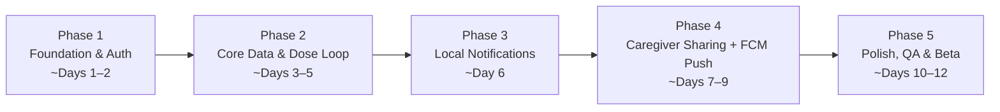
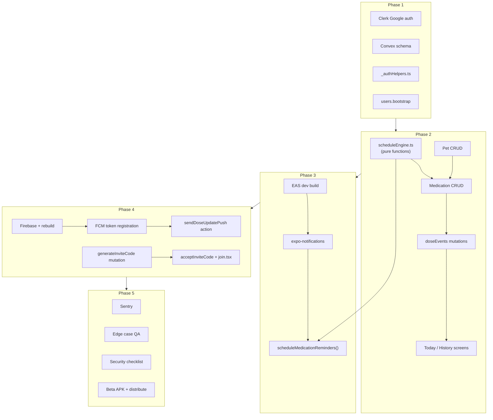

# PetHuddle — Implementation Plan

> **Based on:** PetHuddle-spec.md (interview completed 14 October 2026)
> **Stack:** Expo SDK 57 + React Native 0.86 + TypeScript 6 + Clerk + Convex + FCM + NativeWind
> **Platform:** Android-only (EAS Build)
> **State:** Blank Expo project initialized (`expo ~57.0.28`)

---

## How to Read This Plan

Each phase has:
- **Goal** — what must be demonstrably working before moving on
- **Tasks** — ordered, with exact commands where relevant
- **Acceptance Criteria** — the definition of done for the phase
- **Blocking dependencies** — what must exist before this phase starts

Phases are sequential. Do not start Phase 2 until Phase 1's acceptance criteria are met.

---

## Phase Overview



> [!NOTE]
> The original 10-day plan assumed a solo app. Because you locked in caregiver sharing + FCM push for v1, the realistic timeline is **12–16 working days** for a solo founder. Phases 1–3 are the core solo loop; Phase 4 is where the shared-care value unlocks.

---

## Pre-Phase: One-Time Dashboard Setup

Complete these before writing a single line of code. Each one has a secret or config value that must exist before the code that uses it.

| Task | Where | Output needed |
|---|---|---|
| Create Clerk application | [clerk.com](https://clerk.com) → New application → Enable Google provider only | `EXPO_PUBLIC_CLERK_PUBLISHABLE_KEY` |
| Create Convex deployment | [convex.dev](https://convex.dev) → New project | `EXPO_PUBLIC_CONVEX_URL` |
| Configure Clerk JWT in Convex | Convex dashboard → Auth → Add Clerk issuer URL | `auth.config.ts` values |
| Create Firebase project | [console.firebase.google.com](https://console.firebase.google.com) → New project → Add Android app (package name: `com.pethuddle.app`) | `google-services.json`, FCM Server Key |
| Create Sentry project | [sentry.io](https://sentry.io) → New project → React Native | `SENTRY_DSN` |
| Create EAS project | `bunx eas-cli login` then `bunx eas-cli init` | `EAS Project ID` in `app.json` |
| Trademark / domain check | Manual research | Go / No-go on "PetHuddle" name |

> [!NOTE]
> **No email provider or domain needed.** Caregiver invites use a short in-app code (e.g. `PH-4X9K`). Resend and domain setup are post-beta concerns only.

Store server secrets (FCM Server Key) **only** in Convex dashboard environment variables. Never in the Expo bundle.

---

## Repository Structure

Set this up at the start of Phase 1 and do not deviate.

```
d:\PetHuddle\
├── app.json                        # Expo config — add EAS projectId, android package
├── .env.local                      # EXPO_PUBLIC_ vars only — gitignored
├── eas.json                        # EAS build profiles
├── src/
│   └── app/                        # Expo Router file-based routes
│       ├── _layout.tsx             # Root layout — Clerk + Convex providers
│       ├── index.tsx               # Redirect: authed → /(tabs)/today, unauthed → /welcome
│       ├── welcome.tsx
│       ├── (auth)/
│       │   ├── _layout.tsx
│       │   └── sign-in.tsx         # Clerk Google sign-in
│       ├── (tabs)/
│       │   ├── _layout.tsx         # Bottom tab bar
│       │   ├── today.tsx
│       │   ├── pets.tsx
│       │   ├── history.tsx
│       │   └── settings.tsx
│       ├── pets/
│       │   ├── new.tsx             # Create pet form
│       │   └── [petId].tsx         # Pet profile
│       ├── medications/
│       │   ├── new.tsx             # Add medication (details step)
│       │   ├── [medicationId].tsx  # Medication detail / edit
│       │   └── schedule.tsx        # Schedule configuration step
│       ├── dose-events/
│       │   └── [eventId].tsx       # Correction flow
│       ├── household/
│       │   ├── index.tsx           # Member list + Generate Code + revoke
│       │   └── join.tsx            # "Enter invite code" screen (caregiver entry point)
│       └── settings/
│           ├── notifications.tsx
│           └── privacy.tsx
├── src/
│   ├── components/
│   │   ├── DoseCard.tsx
│   │   ├── DoseStatusBadge.tsx
│   │   ├── PetAvatar.tsx
│   │   ├── FormField.tsx
│   │   ├── EmptyState.tsx
│   │   ├── OfflineBanner.tsx
│   │   ├── NotificationPermissionBanner.tsx
│   │   └── ConfirmDialog.tsx
│   ├── lib/
│   │   ├── convex.ts               # ConvexReactClient singleton
│   │   ├── clerk.ts                # Clerk token cache helper
│   │   ├── notifications.ts        # Local notification scheduling helpers
│   │   ├── scheduleEngine.ts       # "What's due today?" computation — pure functions
│   │   ├── dateTime.ts             # Timezone-aware date helpers (using date-fns-tz)
│   │   └── validation.ts           # Zod schemas shared between client and server
│   └── hooks/
│       ├── useNetworkStatus.ts
│       └── useHouseholdRole.ts
├── convex/
│   ├── _generated/                 # Auto-generated — never edit manually
│   ├── schema.ts                   # Convex table definitions + indexes
│   ├── auth.config.ts              # Clerk issuer config
│   ├── _authHelpers.ts             # requireMember(), requireOwner() — used by all mutations
│   ├── users.ts
│   ├── pets.ts
│   ├── medications.ts
│   ├── doseEvents.ts
│   ├── households.ts
│   ├── notifications.ts            # FCM push action
│   └── subscriptions.ts            # Entitlement stub
└── assets/
    └── (existing icons + splash)
```

---

## Phase 1 — Foundation & Auth

**Goal:** Authenticated user can open the app, sign in with Google, and see the Today tab (empty state). The Convex backend is connected and returns an authenticated query result.

### 1.1 Clean up the blank project

```powershell
# Remove the default App.tsx entry point — Expo Router takes over
Remove-Item d:\PetHuddle\App.tsx
```

Update `package.json` `"main"` field:
```json
"main": "expo-router/entry"
```

### 1.2 Install core dependencies

Run each group separately so errors are easy to diagnose.

```powershell
# Expo Router (file-based navigation)
npx expo install expo-router react-native-safe-area-context react-native-screens expo-linking expo-constants expo-status-bar

# Clerk auth
npx expo install @clerk/expo expo-secure-store expo-web-browser expo-auth-session

# Convex backend client
npx expo install convex

# NativeWind styling (Tailwind for RN)
npx expo install nativewind tailwindcss

# Zod validation
npx expo install zod

# Date helpers (timezone-aware)
npx expo install date-fns date-fns-tz

# Image picker (pet photos)
npx expo install expo-image-picker

# Network state (offline banner)
npx expo install @react-native-community/netinfo
```

### 1.3 Configure NativeWind

```powershell
bunx tailwindcss init
```

`tailwind.config.js`:
```js
/** @type {import('tailwindcss').Config} */
module.exports = {
  content: ["./src/**/*.{js,jsx,ts,tsx}"],
  presets: [require("nativewind/preset")],
  theme: { extend: {} },
  plugins: [],
};
```

Add to `babel.config.js`:
```js
plugins: ["nativewind/babel"],
```

Add to `metro.config.js` (create if missing):
```js
const { getDefaultConfig } = require("expo/metro-config");
const { withNativeWind } = require("nativewind/metro");
const config = getDefaultConfig(__dirname);
module.exports = withNativeWind(config, { input: "./global.css" });
```

Create `global.css`:
```css
@tailwind base;
@tailwind components;
@tailwind utilities;
```

### 1.4 Configure Expo Router + app.json

Update `app.json`:
```json
{
  "expo": {
    "name": "PetHuddle",
    "slug": "PetHuddle",
    "scheme": "pethuddle",
    "version": "1.0.0",
    "orientation": "portrait",
    "icon": "./assets/icon.png",
    "userInterfaceStyle": "light",
    "android": {
      "package": "com.pethuddle.app",
      "adaptiveIcon": {
        "foregroundImage": "./assets/android-icon-foreground.png",
        "backgroundImage": "./assets/android-icon-background.png",
        "monochromeImage": "./assets/android-icon-monochrome.png",
        "backgroundColor": "#E6F4FE"
      },
      "googleServicesFile": "./google-services.json",
      "intentFilters": [
        {
          "action": "VIEW",
          "data": [{ "scheme": "pethuddle" }],
          "category": ["BROWSABLE", "DEFAULT"]
        }
      ]
    },
    "plugins": [
      "expo-router",
      "expo-secure-store"
    ]
  }
}
```

Create `.env.local`:
```env
EXPO_PUBLIC_CLERK_PUBLISHABLE_KEY=pk_test_...
EXPO_PUBLIC_CONVEX_URL=https://...convex.cloud
```

### 1.5 Convex schema — define all tables upfront

`convex/schema.ts`:

```ts
import { defineSchema, defineTable } from "convex/server";
import { v } from "convex/values";

export default defineSchema({
  userProfiles: defineTable({
    clerkUserId: v.string(),
    displayName: v.string(),
    avatarUrl: v.optional(v.string()),
    timezone: v.string(),
    createdAt: v.number(),
  }).index("by_clerk_user", ["clerkUserId"]),

  households: defineTable({
    name: v.optional(v.string()),
    createdBy: v.string(),
    createdAt: v.number(),
  }),

  householdMembers: defineTable({
    householdId: v.id("households"),
    clerkUserId: v.string(),
    role: v.union(v.literal("owner"), v.literal("caregiver")),
    status: v.union(v.literal("active"), v.literal("pending"), v.literal("revoked")),
    inviteTokenHash: v.optional(v.string()),
    inviteExpiry: v.optional(v.number()),
    invitedBy: v.optional(v.string()),
    invitedAt: v.optional(v.number()),
    inviteeEmail: v.optional(v.string()),
    acceptedAt: v.optional(v.number()),
  })
    .index("by_household", ["householdId"])
    .index("by_clerk_user", ["clerkUserId"])
    .index("by_household_and_user", ["householdId", "clerkUserId"])
    .index("by_invite_token_hash", ["inviteTokenHash"]),

  pets: defineTable({
    householdId: v.id("households"),
    name: v.string(),
    species: v.union(v.literal("dog"), v.literal("cat")),
    breed: v.optional(v.string()),
    birthday: v.optional(v.string()),
    photoStorageId: v.optional(v.id("_storage")),
    status: v.union(v.literal("active"), v.literal("archived")),
    createdBy: v.string(),
    createdAt: v.number(),
  })
    .index("by_household", ["householdId"])
    .index("by_household_and_status", ["householdId", "status"]),

  medications: defineTable({
    petId: v.id("pets"),
    householdId: v.id("households"),
    displayName: v.string(),
    form: v.optional(v.string()),
    instructionText: v.string(),
    scheduleType: v.union(v.literal("scheduled"), v.literal("as_needed")),
    schedule: v.optional(v.object({
      frequencyType: v.union(
        v.literal("daily"),
        v.literal("multi_daily"),
        v.literal("course")
      ),
      timesOfDay: v.array(v.string()),
      startDate: v.string(),
      endDate: v.optional(v.string()),
      timezone: v.string(),
    })),
    status: v.union(
      v.literal("active"),
      v.literal("paused"),
      v.literal("completed"),
      v.literal("archived")
    ),
    planVersion: v.number(),
    createdBy: v.string(),
    updatedBy: v.optional(v.string()),
    createdAt: v.number(),
    updatedAt: v.number(),
  })
    .index("by_pet", ["petId"])
    .index("by_household", ["householdId"])
    .index("by_pet_and_status", ["petId", "status"]),

  doseEvents: defineTable({
    petId: v.id("pets"),
    medicationId: v.id("medications"),
    householdId: v.id("households"),
    scheduledFor: v.optional(v.number()),
    status: v.union(
      v.literal("given"),
      v.literal("skipped"),
      v.literal("uncertain"),
      v.literal("corrected")
    ),
    recordedAt: v.number(),
    recordedBy: v.string(),
    givenAt: v.optional(v.number()),
    note: v.optional(v.string()),
    source: v.union(v.literal("manual"), v.literal("notification_action")),
    correctsEventId: v.optional(v.id("doseEvents")),
    createdAt: v.number(),
  })
    .index("by_medication", ["medicationId"])
    .index("by_pet", ["petId"])
    .index("by_household", ["householdId"])
    .index("by_medication_and_scheduled", ["medicationId", "scheduledFor"]),

  notificationTokens: defineTable({
    clerkUserId: v.string(),
    fcmToken: v.string(),
    platform: v.literal("android"),
    updatedAt: v.number(),
  })
    .index("by_clerk_user", ["clerkUserId"])
    .index("by_fcm_token", ["fcmToken"]),

  auditEvents: defineTable({
    actorId: v.string(),
    objectType: v.string(),
    objectId: v.string(),
    action: v.string(),
    timestamp: v.number(),
    diff: v.optional(v.any()),
  }).index("by_object", ["objectType", "objectId"]),

  subscriptions: defineTable({
    householdId: v.id("households"),
    entitlement: v.union(v.literal("free"), v.literal("pro")),
    source: v.union(v.literal("manual"), v.literal("revenuecat")),
    lastVerifiedAt: v.number(),
  }).index("by_household", ["householdId"]),
});
```

### 1.6 Authorization helpers — build FIRST, use in every mutation

`convex/_authHelpers.ts`:
```ts
import { QueryCtx, MutationCtx } from "./_generated/server";
import { Id } from "./_generated/dataModel";
import { ConvexError } from "convex/values";

export async function requireAuth(ctx: QueryCtx | MutationCtx): Promise<string> {
  const identity = await ctx.auth.getUserIdentity();
  if (!identity) throw new ConvexError("Unauthenticated");
  return identity.subject; // Clerk user ID
}

export async function requireMember(
  ctx: QueryCtx | MutationCtx,
  householdId: Id<"households">
) {
  const clerkUserId = await requireAuth(ctx);
  const membership = await ctx.db
    .query("householdMembers")
    .withIndex("by_household_and_user", (q) =>
      q.eq("householdId", householdId).eq("clerkUserId", clerkUserId)
    )
    .unique();
  if (!membership || membership.status !== "active") {
    throw new ConvexError("Forbidden: not an active member of this household");
  }
  return { membership, clerkUserId };
}

export async function requireOwner(
  ctx: MutationCtx,
  householdId: Id<"households">
) {
  const result = await requireMember(ctx, householdId);
  if (result.membership.role !== "owner") {
    throw new ConvexError("Forbidden: owner role required");
  }
  return result;
}
```

### 1.7 Root layout with providers

`src/app/_layout.tsx`:
```tsx
import "../global.css";
import { ClerkProvider, ClerkLoaded, useAuth } from "@clerk/expo";
import { ConvexProviderWithClerk } from "convex/react-clerk";
import { ConvexReactClient } from "convex";
import { tokenCache } from "@/lib/clerk";
import { Slot } from "expo-router";
import { StatusBar } from "expo-status-bar";

const convex = new ConvexReactClient(process.env.EXPO_PUBLIC_CONVEX_URL!);

export default function RootLayout() {
  return (
    <ClerkProvider
      publishableKey={process.env.EXPO_PUBLIC_CLERK_PUBLISHABLE_KEY!}
      tokenCache={tokenCache}
    >
      <ConvexProviderWithClerk client={convex} useAuth={useAuth}>
        <ClerkLoaded>
          <StatusBar style="auto" />
          <Slot />
        </ClerkLoaded>
      </ConvexProviderWithClerk>
    </ClerkProvider>
  );
}
```

### 1.8 User bootstrap mutation

`convex/users.ts` — idempotently creates `userProfile` + `household` + owner `householdMember` + free `subscription` on first sign-in. Call this mutation from the tab layout `useEffect` on first mount for a signed-in user.

### Phase 1 Acceptance Criteria

- [ ] `bunx expo start` runs without errors
- [ ] `npx tsc --noEmit` passes with zero errors
- [ ] `npx expo lint` passes
- [ ] Google sign-in works on a physical Android device (development build required — `bunx eas-cli build --profile development --platform android`)
- [ ] After sign-in, `users.bootstrap` creates household + member rows (visible in Convex dashboard)
- [ ] Today tab renders empty state for authenticated user
- [ ] Unauthenticated user is redirected to `/welcome`
- [ ] No API keys in any committed file

---

## Phase 2 — Core Data & Dose Loop

**Goal:** User can create a pet, add a medication with a schedule, log a dose outcome (Given / Skipped / Not sure), and see that event in History.

### 2.1 Schedule engine — build and test as pure functions FIRST

> [!IMPORTANT]
> Build `src/lib/scheduleEngine.ts` as pure TypeScript before any UI. It has no React or Convex dependency and can be manually tested with `console.log` in a scratch script.

Core function signature:
```ts
export function getOccurrencesInWindow(
  rule: ScheduleRule,
  windowStart: Date,
  windowEnd: Date,
): ScheduledOccurrence[]
```

**Algorithm:**
1. Clamp iteration start to `max(rule.startDate, windowStart)`
2. Clamp iteration end to `min(rule.endDate ?? +90days, windowEnd)`
3. Walk day by day (max 90-day guard to prevent runaway)
4. For each day, for each `timesOfDay` entry: build the local datetime in `rule.timezone`, convert to UTC, check if in window, push to results
5. Sort results ascending

**Manual tests to verify before moving on:**
- Daily at 08:00 America/New_York → exactly 1 UTC occurrence per day at correct offset
- Multi-daily 08:00 + 20:00 → 2 occurrences per day
- Course with `endDate: "2026-10-20"` → zero occurrences after Oct 20
- Timezone boundary: 23:00 CET should appear on the right UTC calendar date

### 2.2 Validation schemas

`src/lib/validation.ts` — Zod schemas for forms and server boundary:
- `scheduleRuleSchema` — validates `timesOfDay` format, `startDate` format, `frequencyType` enum
- `createMedicationSchema` — validates all medication fields
- `createPetSchema` — validates name, species, optional breed/birthday

### 2.3 Convex function implementations

Implement in this order (each depends on the previous):

**`convex/users.ts`**
- `bootstrap` — idempotent first-sign-in setup (household + member + subscription)
- `getMyProfile` — returns current user's profile + householdId

**`convex/pets.ts`**
- `listMyPets` — `requireAuth` → lookup household → list active pets
- `createPet` — `requireMember` (lookup household from DB, not client) → insert
- `updatePet` — `requireMember` → patch
- `archivePet` — `requireOwner` → soft delete
- `generatePhotoUploadUrl` — `requireMember` → `ctx.storage.generateUploadUrl()`

**`convex/medications.ts`**
- `listMedications(petId)` — `requireMember` (verify pet's householdId) → list active meds
- `getMedication(medicationId)` — `requireMember` → return
- `createMedication` — `requireMember` → validate with Zod → insert with `planVersion: 1`
- `updateMedication` — `requireOwner` → increment `planVersion` → patch → insert `auditEvent`
- `pauseMedication` / `archiveMedication` — `requireOwner` → status update

**`convex/doseEvents.ts`**
- `logDoseOutcome` — `requireMember` → idempotency check → insert → schedule FCM push (Phase 4 stub)
- `correctDoseEvent` — `requireMember` → create new event with `correctsEventId` → patch old event to `"corrected"`
- `getDosesForToday` — `requireMember` → for each active scheduled medication, compute today's occurrences via `scheduleEngine`, join with existing `doseEvents`
- `getDoseHistory(petId, limit, cursor)` — `requireMember` → paginated query

### 2.4 Screen build order

Build in this order — each screen depends on the Convex functions above it:

1. `/pets/new.tsx` — form: name, species toggle (Dog/Cat), optional photo
2. `/(tabs)/pets.tsx` — list pets + "Add pet" FAB
3. `/medications/new.tsx` — details step: name, instruction text, form type
4. `/medications/schedule.tsx` — schedule step: frequency picker, time picker(s), start/end dates
5. Confirm schedule screen — human-readable preview before save
6. `/(tabs)/today.tsx` — `DoseCard` list from `getDosesForToday`
7. Dose action bottom sheet — Given / Skipped / Not sure + optional note
8. Not-sure guidance modal — static safety text, no action buttons that suggest a dose
9. `/(tabs)/history.tsx` — paginated event list with status badges
10. `/dose-events/[eventId].tsx` — correction form

### 2.5 DoseCard — the most critical component

Every `DoseCard` must show:
- Pet name + species avatar (prevents wrong-pet mistakes)
- Medication name
- Scheduled time (in user's local timezone)
- Status badge (color + icon + text label — never color alone)
- If logged: "Recorded as given by [displayName] at [time]" — not "verified"
- If uncertain: amber ⚠ "Needs checking — tap to review"

Status display rules:

| Status | Color | Icon | Label |
|---|---|---|---|
| Upcoming | Gray | Clock | "Due at [time]" |
| Due | Blue | Bell | "Due now" |
| Overdue/Unresolved | Orange | Alert | "Needs attention" |
| Given | Green | Check | "Recorded as given" |
| Skipped | Gray | Slash | "Recorded as skipped" |
| Uncertain | Amber | Warning | "Needs checking" |

### Phase 2 Acceptance Criteria

- [ ] Can create a pet (dog/cat) with optional photo uploaded to Convex Storage
- [ ] Can add a medication with instruction text + daily/multi-daily/course schedule
- [ ] Confirm schedule screen shows human-readable preview before saving
- [ ] Today dashboard shows correct dose cards for today's occurrences (correct timezone)
- [ ] Can log Given / Skipped / Not sure — event written with actor + timestamp
- [ ] "Not sure" shows safety guidance; no repeat-dose advice anywhere
- [ ] Correction flow creates new event, marks old event as "corrected"; old event visible in history
- [ ] A second account cannot read or write another user's data (test manually with two accounts)
- [ ] `npx tsc --noEmit` passes; `npx expo lint` passes

---

## Phase 3 — Local Notifications

**Goal:** After saving a schedule, the device schedules local notifications at the configured times. Notification tap navigates to the correct dose card. Editing/archiving a medication correctly cancels and replaces its notifications.

> [!IMPORTANT]
> Local notifications require a **development build**. Rebuild with EAS: `bunx eas-cli build --profile development --platform android`

### 3.1 Install

```powershell
npx expo install expo-notifications expo-device
```

Add plugin to `app.json`:
```json
["expo-notifications", {
  "icon": "./assets/android-icon-foreground.png",
  "color": "#E6F4FE"
}]
```

### 3.2 Notification helper functions

`src/lib/notifications.ts` — key functions:

```ts
// Set notification behavior while app is foregrounded
Notifications.setNotificationHandler({
  handleNotification: async () => ({
    shouldShowAlert: true,
    shouldPlaySound: true,
    shouldSetBadge: false,
  }),
});

// Request permission with context
export async function requestNotificationPermission(): Promise<string>

// Schedule 8-week rolling horizon for one medication
// Cancels existing notifications for this medication first
// Stores returned notification IDs in AsyncStorage keyed by medicationId
export async function scheduleMedicationReminders(
  medicationId: string,
  petName: string,
  medicationName: string,
  rule: ScheduleRule,
): Promise<void>

// Cancel all notifications for a medication (call on edit/pause/archive)
export async function cancelMedicationReminders(medicationId: string): Promise<void>

// Refresh all active medications' notifications (call on app foreground)
export async function refreshAllReminders(activeMedications: MedWithSchedule[]): Promise<void>
```

Notification content data must include `{ medicationId, scheduledFor: ISO string }` for deep link routing.

### 3.3 Deep link routing from notification tap

In root `_layout.tsx`:
```tsx
// Handle tap when app was closed
Notifications.getLastNotificationResponseAsync().then((response) => {
  const data = response?.notification.request.content.data;
  if (data?.medicationId) {
    router.push(`/medications/${data.medicationId}`);
  }
});

// Handle tap when app is open or backgrounded
const sub = Notifications.addNotificationResponseReceivedListener((response) => {
  const data = response.notification.request.content.data;
  if (data?.medicationId) {
    router.push(`/medications/${data.medicationId}`);
  }
});
```

### 3.4 Foreground refresh

In the tab `_layout.tsx`:
```tsx
AppState.addEventListener("change", (state) => {
  if (state === "active") refreshAllReminders(activeMedications);
});
```

### 3.5 Notification permission UX

- Show `NotificationPermissionBanner` when permission is not `granted`
- `undetermined` → show inline explainer + request button
- `denied` → show "Reminders are off" + "Open Settings" → `Linking.openSettings()`
- Never claim reminders are active when permission is denied

### Phase 3 Acceptance Criteria

- [ ] Notifications scheduled after medication creation (verify in device notification list)
- [ ] Notification fires at configured time on physical Android device
- [ ] Tapping notification navigates to correct medication/dose card
- [ ] Archiving/pausing medication cancels its notifications
- [ ] Editing schedule cancels old notifications + schedules new ones
- [ ] `NotificationPermissionBanner` visible when permission is denied
- [ ] No unhandled errors when notification permission is denied

---

## Phase 4 — Caregiver Sharing & FCM Push

**Goal:** Owner generates a short invite code (e.g. `PH-4X9K`). Caregiver enters the code in-app → joins the household → both see the same dose timeline in real time. When any member logs a dose, other household members receive an FCM push notification.

> [!CAUTION]
> This phase has the highest security surface area. Every mutation must call `requireMember` or `requireOwner`. Complete the access-control test matrix (section 4.6) before calling this phase done.

### Invite Code Design

| Property | Value |
|---|---|
| **Format** | `PH-XXXX` where XXXX = 4 chars from safe alphabet `ACDEFGHJKLMNPQRTUVWXY34679` (no 0/O, 1/I/L ambiguity) |
| **Example** | `PH-4X9K` |
| **Expiry** | 24 hours from generation |
| **Usage** | Single-use — invalidated immediately on acceptance |
| **Storage** | Only the SHA-256 **hash** is stored in Convex. The raw code is returned to the client once and never stored. |
| **Rate limit** | Max 5 wrong attempts per user session — prevents brute force |
| **Sharing** | Owner shares code however they like — WhatsApp, SMS, verbally, screenshot |

### 4.1 Install Firebase + rebuild

```powershell
npx expo install @react-native-firebase/app @react-native-firebase/messaging
```

Add to `app.json` plugins:
```json
"@react-native-firebase/app",
"@react-native-firebase/messaging"
```

Add `google-services.json` to project root.

Rebuild development build:
```powershell
bunx eas-cli build --profile development --platform android
```

> [!NOTE]
> No `intentFilters` or deep link setup needed in `app.json` — the invite code flow is entirely in-app. This simplifies the build configuration.

### 4.2 FCM token registration

After sign-in + bootstrap, register FCM token:
```ts
const token = await messaging().getToken();
await convex.mutation(api.notifications.upsertFcmToken, { fcmToken: token });

// Refresh on token rotation
messaging().onTokenRefresh((token) => {
  convex.mutation(api.notifications.upsertFcmToken, { fcmToken: token });
});
```

`convex/notifications.ts`:
- `upsertFcmToken` — `requireAuth` → upsert in `notificationTokens`
- `sendDoseUpdatePush` (action) — look up other household members' tokens → POST to FCM HTTP API → remove stale tokens on `InvalidRegistration`
- `removeFcmToken` — mutation to delete a stale token

FCM Server Key stored only in Convex env var `FCM_SERVER_KEY`.

### 4.3 Trigger push from dose logging

In `doseEvents.logDoseOutcome`, after writing the event:
```ts
await ctx.scheduler.runAfter(0, api.notifications.sendDoseUpdatePush, {
  householdId: medication.householdId,
  actorClerkUserId: clerkUserId,
  petName: pet.name,
  medicationName: medication.displayName,
  status: args.status,
});
```

### 4.4 Household invitation flow — invite code

`convex/households.ts`:

**`generateInviteCode`** (mutation — `requireOwner`):
```ts
// 1. Generate 4 random chars from safe alphabet
const safeAlphabet = "ACDEFGHJKLMNPQRTUVWXY34679";
const rawCode = "PH-" + Array.from(
  { length: 4 },
  () => safeAlphabet[Math.floor(Math.random() * safeAlphabet.length)]
).join("");

// 2. Hash it — store only the hash
const hash = await sha256(rawCode); // use crypto.subtle or a simple impl

// 3. Insert pending householdMember row
await ctx.db.insert("householdMembers", {
  householdId,
  clerkUserId: "",          // empty until accepted
  role: "caregiver",
  status: "pending",
  inviteTokenHash: hash,
  inviteExpiry: Date.now() + 24 * 60 * 60 * 1000, // 24 hours
  invitedBy: clerkUserId,
  invitedAt: Date.now(),
});

// 4. Return the raw code to the client (ONLY time it's visible)
return rawCode; // e.g. "PH-4X9K"
```

**`acceptInviteCode`** (mutation — called after sign-in):
```ts
// args: { rawCode: string }
// 1. Normalize input: uppercase, strip spaces
// 2. Hash the input → look up by inviteTokenHash
// 3. Check inviteExpiry — throw ConvexError("Code expired") if past
// 4. Check status === "pending" — throw ConvexError("Code already used") if not
// 5. requireAuth → get clerkUserId
// 6. Check user is not already in a household (optional — allow joining multiple as caregiver)
// 7. Set status: "active", clerkUserId, acceptedAt: Date.now()
// 8. If new user, create userProfile
// 9. Return householdId so client can redirect to /(tabs)/today
```

**`revokeCaregiver`** (mutation — `requireOwner`):
- Set `status: "revoked"` on the member row

**`revokeInviteCode`** (mutation — `requireOwner`):
- Find pending member by householdId + status "pending" → set `status: "revoked"`
- Owner can cancel an unused code before it's accepted

**`listHouseholdMembers`** (query — `requireMember`):
- Return all members with display names joined from `userProfiles`
- Include pending members so owner can see "Awaiting acceptance" state

### 4.5 Screens for Phase 4

**`/household/index.tsx`** — Owner view:
- List of active members with role badges (Owner / Caregiver)
- Pending members shown as "Awaiting acceptance"
- **"Generate Invite Code"** button → calls `generateInviteCode` → displays code in a large, copyable card:
  ```
  ┌─────────────────────────────┐
  │  Invite Code                │
  │                             │
  │     PH - 4X9K               │  ← large, bold, easy to read
  │                             │
  │  Expires in 24 hours        │
  │  [Copy Code]  [Share]       │  ← Share opens OS share sheet
  └─────────────────────────────┘
  ```
- "Share" button: `Share.share({ message: "Join my pet's care on PetHuddle! Enter code: PH-4X9K" })`
- "Copy" button: `Clipboard.setStringAsync("PH-4X9K")` + toast "Code copied!"
- Revoke member button (owner only, with confirmation dialog)

**`/household/join.tsx`** — Caregiver entry point:
- Text input for the code (6 chars with auto-uppercase + auto-hyphen formatting)
- "Join Household" button → calls `acceptInviteCode`
- On success: redirect to `/(tabs)/today` with a welcome message
- On error: clear messages:
  - "Code not found — check and try again"
  - "This code has expired — ask the owner to generate a new one"
  - "This code has already been used"

**Where to surface `/household/join.tsx`:**
1. **Onboarding** — after sign-in, show "Do you have an invite code?" with "Enter Code" button
2. **Settings tab** — "Join a Household" option for users already in the app

### 4.6 Access control test matrix

Test with two separate Google accounts before shipping:

| Scenario | Expected result |
|---|---|
| Account B reads Account A's pet by ID | Convex throws `Forbidden` |
| Account B logs dose on Account A's medication | Mutation throws `Forbidden` |
| Caregiver tries to generate an invite code | Mutation throws `Forbidden: owner role required` |
| Caregiver tries to archive a medication | Mutation throws `Forbidden` |
| Expired invite code entered | `acceptInviteCode` throws `Code expired` |
| Same code entered twice | Second call throws `Code already used` |
| Revoked caregiver logs a dose | `requireMember` throws `Forbidden` |
| Wrong code entered 6 times | Rate limit triggers — temporary lock |

### Phase 4 Acceptance Criteria

- [ ] Owner generates a `PH-XXXX` invite code — displayed clearly in-app
- [ ] "Copy" button copies code to clipboard with toast confirmation
- [ ] "Share" button opens Android OS share sheet with pre-filled message
- [ ] Caregiver enters code in `/household/join.tsx` → joins household → sees Today dashboard
- [ ] Caregiver entry point is available in onboarding AND in Settings
- [ ] Code expires after 24 hours (test by manually setting `inviteExpiry` to a past time in Convex dashboard)
- [ ] Code is single-use — second entry attempt shows clear error
- [ ] Caregiver logs a dose; owner sees updated event with caregiver's name in real time
- [ ] Owner receives FCM push when caregiver logs a dose (and vice versa)
- [ ] Stale FCM tokens cleaned up on `InvalidRegistration`
- [ ] All 8 access-control scenarios in section 4.6 produce expected errors
- [ ] Revoking a caregiver immediately prevents their next mutation
- [ ] No domain, no email, no deep links required — 100% in-app
- [ ] `npx tsc --noEmit` passes; `npx expo lint` passes


---

## Phase 5 — Polish, QA & Beta

**Goal:** App is stable enough for 5–10 real testers. All safety rules enforced. Edge cases handled gracefully.

### 5.1 Sentry error monitoring

```powershell
npx expo install @sentry/react-native
```

Add plugin to `app.json`. Initialize in root layout. Configure `beforeSend` to strip `instructionText`, `note`, and email fields from error payloads.

### 5.2 EAS build profiles

`eas.json`:
```json
{
  "cli": { "version": ">= 12.0.0" },
  "build": {
    "development": {
      "developmentClient": true,
      "distribution": "internal",
      "android": { "buildType": "apk" }
    },
    "preview": {
      "distribution": "internal",
      "android": { "buildType": "apk" }
    },
    "production": {
      "android": { "buildType": "aab" }
    }
  }
}
```

### 5.3 Settings screens

- Notification settings — permission status, test notification button, "Open device settings" link
- Household — member list, invite, revoke (Phase 4 screens)
- Plan — Free vs Pro comparison table (stub — no purchase flow wired)
- Privacy & data — privacy policy link, "Request data deletion" (mailto link acceptable for beta)
- Sign out, app version

### 5.4 Edge case checklist

| Scenario | Expected behavior |
|---|---|
| No internet on Today tab | `OfflineBanner` visible; cached data shown; write attempts show error toast |
| Notification permission denied | `NotificationPermissionBanner` shown; reminders not claimed as active |
| Medication archived while notification pending | `cancelMedicationReminders` called |
| Two taps on "Given" (double-tap race) | Idempotency check prevents duplicate event |
| User changes device timezone | Foreground refresh reschedules notifications |
| Correction on already-corrected event | Allowed; original + correction both in history |
| Very long medication name | Text truncated in card; full name visible in detail screen |
| Pet photo upload fails | Error shown; pet saved without photo |

### 5.5 Pre-launch security checklist

- [ ] Every query that returns data calls `requireMember` or `requireAuth`
- [ ] Every mutation calls `requireMember` or `requireOwner` as appropriate
- [ ] No mutation accepts `householdId` or `clerkUserId` from client args without server-side re-verification
- [ ] Invite code stored only as SHA-256 hash; raw code returned to client once and never written to DB
- [ ] No API key (FCM server key) in any `EXPO_PUBLIC_*` variable or committed file
- [ ] `google-services.json` is in `.gitignore`
- [ ] Sentry strips `instructionText`, `note`, and email fields from all error payloads
- [ ] `npx expo-doctor` passes with no warnings

### 5.6 Beta distribution

```powershell
# Build preview APK for internal testers
bunx eas-cli build --profile preview --platform android

# Get download URL
bunx eas-cli build:list
```

Recruit 5–10 testers with a pet on medication. Ask each tester to:
1. Sign in → create pet + medication + schedule
2. Wait for or simulate a notification → log outcome
3. (For multi-caregiver testers) Accept an invite → log a dose as caregiver

### Phase 5 Acceptance Criteria

- [ ] Sentry captures errors without medication text in payloads
- [ ] All 8 edge-case scenarios in section 5.4 behave as expected
- [ ] Pre-launch security checklist fully checked
- [ ] App does not crash during the 3 core beta test flows
- [ ] `npx expo-doctor` passes
- [ ] `npx tsc --noEmit` passes; `npx expo lint` passes
- [ ] Privacy policy URL reachable from within the app
- [ ] Account deletion path functional

---

## Phase Dependency Summary



---

## Post-Beta Backlog (not in v1 scope)

| Feature | Pre-condition |
|---|---|
| RevenueCat billing + store products | 30%+ of testers express willingness to pay |
| Multiple pets (Pro gate) | Billing wired + tested |
| CSV/PDF vet report | History query stable + paginated |
| Inventory / refill alerts | Core dose loop used by real testers for 2+ weeks |
| Sitter mode (expiring access) | `householdMembers` expiry + cleanup scheduled function |
| Groq AI summary | Pro billing live; cost measured per request |
| OCR label capture | Safety review + user demand validated |
| iOS build | Android beta validates the core loop |

---

## All Install Commands (Quick Reference)

```powershell
# Phase 1
npx expo install expo-router react-native-safe-area-context react-native-screens expo-linking expo-constants expo-status-bar
npx expo install @clerk/expo expo-secure-store expo-web-browser expo-auth-session
npx expo install convex
npx expo install nativewind tailwindcss
npx expo install zod
npx expo install date-fns date-fns-tz
npx expo install expo-image-picker
npx expo install @react-native-community/netinfo

# Phase 3
npx expo install expo-notifications expo-device

# Phase 4
npx expo install @react-native-firebase/app @react-native-firebase/messaging
npx expo install expo-clipboard   # for "Copy Code" button in invite flow

# Phase 5
npx expo install @sentry/react-native

# EAS (one-time)
bunx eas-cli login
bunx eas-cli init
```

---

## Key Documentation Links

| Topic | URL |
|---|---|
| Expo SDK 57 reference | https://docs.expo.dev/versions/v57.0.0/ |
| Expo Router | https://docs.expo.dev/router/introduction/ |
| expo-notifications | https://docs.expo.dev/versions/v57.0.0/sdk/notifications/ |
| expo-clipboard | https://docs.expo.dev/versions/v57.0.0/sdk/clipboard/ |
| Clerk + Expo quickstart | https://clerk.com/docs/quickstarts/expo |
| Convex + Clerk | https://docs.convex.dev/auth/clerk |
| Convex React Native quickstart | https://docs.convex.dev/quickstart/react-native |
| Convex file storage | https://docs.convex.dev/file-storage/upload-files |
| EAS Build | https://docs.expo.dev/eas/index.md |
| NativeWind v4 | https://www.nativewind.dev/getting-started/expo-router |
| React Native Firebase | https://rnfirebase.io/ |
| RevenueCat + Expo | https://www.revenuecat.com/docs/getting-started/installation/expo |
